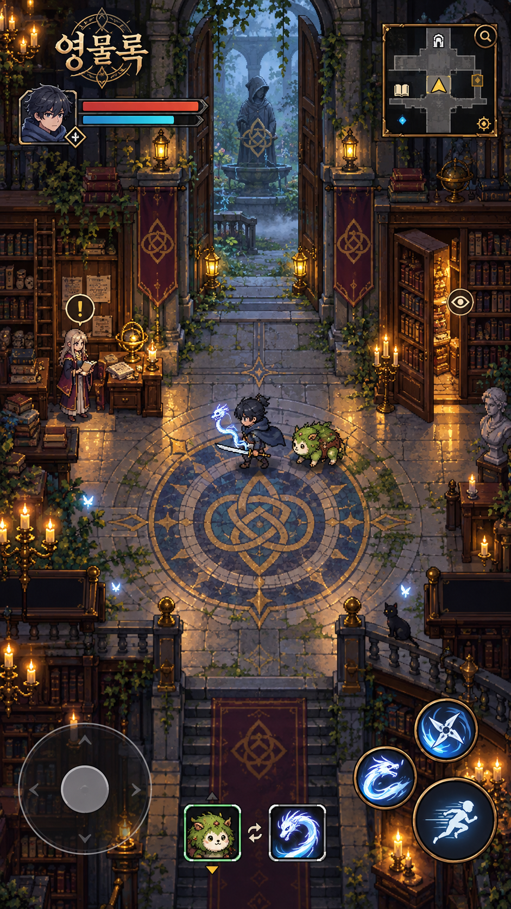

# 아트·UI 방향 v0.1

작성일: 2026-10-10 / 담당: Codex — 총괄·디자인

기준: 사용자가 제시한 작은 캐릭터의 2D 탑다운 RPG 화면, 서구적인 의상·건축, 선명한 액션 만화풍 인물, 마법학교를 탐험하는 분위기. 이 문서는 기존 기획서의 픽셀/스프라이트 후보를 구체화한다. 기능과 Q1~Q5 진행은 기존 기획서를 유지한다.

## 1. 시각 방향

**작은 도트 캐릭터가 오래된 마법 교육원과 주변 나라를 탐험하는 닌자·영물 RPG.**

- 월드: 위에서 내려다보는 정면 기반 2D 탑다운. 지붕과 벽의 높이는 표현하되 지형과 이동 경로를 쉽게 읽게 한다.
- 캐릭터: 게임 화면에는 작은 픽셀 스프라이트, 대화 초상화에는 선명한 윤곽선과 2~3단계 명암의 액션 만화풍 그림.
- 공간: 석조 회랑, 짙은 나무 책장, 황동 램프, 촛불, 덩굴, 수문·공방, 숨은 계단.
- 의상: 짧은 후드 망토, 실용적인 코트, 가죽 장갑과 부츠, 작은 도구 주머니, 가벼운 칼. 인물마다 길이·무게·색으로 실루엣을 구분한다.
- 신비감: 문이 조금 열린 서고, 서로 다른 사용 흔적, 움직이는 작은 조명, 기록의 빈자리로 표현한다. 모든 바닥에 강한 발광 문양을 깔지 않는다.
- 전투: 예고 영역·캐릭터·상호작용물의 윤곽을 우선한다. 장식과 파티클은 중요 정보 뒤에 배치한다.

## 2. 시안과 실제 제작의 구분

이 이미지는 이 대화에서 생성한 **분위기·재질·의상 참고 시안**이다. 확정된 로고, 플레이 가능한 장면, 타일셋, 스프라이트시트가 아니다.

시안의 전경 계단과 벽은 입체감이 강하다. 구현에서는 이동 평면과 발 위치를 더 명확하게 정리한다. 시안의 큰 로고와 큰 미니맵은 실제 전투 화면에서 그대로 사용하지 않는다. 참고할 핵심은 따뜻한 촛불, 차가운 바깥 공기, 석재와 목재, 작은 닌자와 영물의 조합이다.

## 3. 기존 이야기와 연결

이음터를 독립된 새 마법학교로 대체하지 않는다. 기존 조합의 **견습 교육원**이 수로 마을 안에 있는 것으로 설정한다.

| 현재 요소 | 아트 적용 | 유지할 기능 |
| --- | --- | --- |
| 이음터의 집과 우물 | 교육원 작업동, 작은 서고, 석조 우물, 황동 램프 | 출발·단우 대화·상자 수령 |
| 북문 | 덩굴이 낀 석조 아치와 조합의 매듭 표식 | 갈대둑 진입과 체크포인트 |
| 갈대둑 | 학교 밖의 정비용 수로, 축축한 돌길과 갈대 | 철부리새 전투·우회 가능 경로 |
| 수문 | 낡은 석조 수문과 목재·금속 조율 장치 | 하온 전달·역류 사건 |
| 방앗간 | 견습생이 드나드는 오래된 수리 공방 | 줄비 계약과 제작 |

세계는 이후 지역마다 문화가 달라진다. 학교의 색과 건축을 여섯 나라에 똑같이 복제하지 않는다. 기존 유명 작품의 학교명·문장·상징적 인물 외형을 사용하지 않고, 이 세계의 매듭·결·수로를 장식 소재로 쓴다.

## 4. 색과 정보 우선순위

| 용도 | 기본 색 가설 | 사용 원칙 |
| --- | --- | --- |
| 배경 그림자·UI 패널 | `#202833`, `#14202B` | 텍스트 뒤의 안정적인 어두운 면 |
| 오래된 석재 | `#777D78`, `#A2A58F` | 바닥을 중간 밝기로 유지 |
| 목재 | `#49352C`, `#75513A` | 책장·문·작업대 구분 |
| 식물·이끼 | `#4E6650`, `#7B8C57` | 길의 바깥과 영물의 재질 |
| 촛불·황동·목표 | `#D2AD62`, `#F2D28B` | 작은 조명과 상호작용 강조 |
| 결력·영물 효과 | `#5FC5C9` | 비용과 능력 발동의 공통 색 |
| 위험·체력 | `#D9514B`, `#FF795F` | 공격 예고와 피해. 화살표·형태도 함께 사용 |
| 본문 | `#F2EAD6` | 긴 글은 밝은 단색. 장식 글꼴을 본문에 사용하지 않음 |

가독성 우선순위: **공격 예고 → 플레이어·적 → 목표/상호작용 → 능력 효과 → 배경 장식**. 바닥 모자이크와 붉은 깃발이 공격 예고의 모양·색을 방해하면 장식을 줄인다.

## 5. 캐릭터와 영물 제작 규격

현재 월드의 타일 기준은 32px이고, 카메라는 가로 약 320 월드 px를 보여준다. 물리와 맵을 한꺼번에 확대하지 않는다.

- 시작 권장 캐릭터 프레임: **32×40px**, 4방향. 머리·망토·부츠를 구분하는 약 3~4등신의 작은 스프라이트.
- 기존 플레이어 위치와 충돌 반경은 보존하고 그림만 교체한다. 현재 그림자의 로컬 기준이 `(0, 8)`이므로 스프라이트 발을 여기에 맞춘다. 32×40 프레임을 쓸 때 중앙 정렬 기준 오프셋 `(0, -12)`부터 검토한다.
- 먼저 4방향 정지 4프레임과 이동 각 4프레임을 제작한다. 공격·회피·피격은 이후 추가한다. 프레임 수는 초기 제작 예산이며 확정 규격은 첫 적용 뒤 확인한다.
- 원본 픽셀에 선명한 필터를 적용하고 불필요한 블러를 피한다. 다양한 화면에서 카메라 확대 시 흔들림·반픽셀 경계를 점검한다.
- 초상화는 256×256 PNG부터 준비한다. 스프라이트와 머리·의상·표식·색을 일치시킨다.
- 플레이어는 청회색 짧은 망토, 장도, 도구 벨트. 단우는 올리브색 긴 작업 코트와 수선 자국, 하온은 회보라색 방수 앞치마, 매듭은 청록색 소매와 줄 꾸러미를 사용한다.
- 도톰은 이끼색 털·여섯 발·잎 무늬, 줄비는 얇은 비늘과 긴 몸. 두 영물은 작은 크기에서도 실루엣으로 구분되어야 한다.
- 신발 변신은 발등·발자국 무늬, 무기 변신은 겹날·비늘로 표현한다. 변신에 긴 컷신을 사용하지 않는다.

권장 자산 위치는 `game/assets/characters/`, `spirits/`, `tiles/`, `ui/`, `portraits/`. 스프라이트와 타일에 투명 배경을 사용한다. 하나의 거대한 배경 이미지를 타일·충돌·오브젝트를 대신하는 용도로 사용하지 않는다.

## 6. 모바일 UI와 카메라

기준 해상도는 기존 **720×1280 세로**, 실제 기기에서는 UI 크기와 안전 영역을 함께 확인한다.

| 영역 | 디자인 기준 |
| --- | --- |
| 상단 상태 | 좌측의 작은 초상화와 체력·결력. 재화·장비 상세는 필요 시 확장 |
| 퀘스트 | 한 줄 목표 중심, 긴 내용은 눌러 펼치기. 상시 정보가 화면 상단 약 180px 이내에 들어가는 안부터 검토 |
| 튜토리얼 | 한 번에 한 행동, 완료하면 접기. 적의 예고나 플레이어를 가리지 않는 위치 |
| 이동 | 좌하단 기존 이동 패드. 드래그와 두 손가락 조작 보존 |
| 회피·기술 | 우하단. 회피를 가장 쉽게 누르게 유지. 사용 불가 상태는 비용·대기시간을 함께 표시 |
| 영물 | Q2 계약 후 활성 1칸만 표시. 레벨 12 이후 2칸. 초상화에 동행/신발/무기 상태 표시 |
| 대화 | 짧은 대사는 작은 패널, 긴 대사에만 높이 확장. 텍스트를 위해 몸과 목적지를 항상 가리지 않음 |
| 미니맵·로고 | Q1 단계에는 새로 추가하지 않음. 후속 탐험에서 소형 미니맵 검토, 로고는 제목 화면 |

터치 영역은 360dp 폭 화면에서 최소 48dp를 출발점으로 한다. 720px 기준에서는 약 96px에 해당하며 실제 배율에서 확인한다. 보이는 버튼과 입력 판정의 위치를 함께 수정하고, 영물 초상화·기술 버튼의 입력 영역이 겹치지 않게 한다.

영물 2칸 배치 가설은 각 72px 프레임, 중심 `(296, 1020)`, `(392, 1020)`. 기존 조작 위치와 겹침 여부를 실제 화면에서 확인한 뒤 적용한다. 계약 전에는 비어 있는 잠금 아이콘을 늘어놓지 않는다.

카메라는 시작·마을 끝·수문 끝에서 플레이어가 전투 화면의 세로 약 **45~62%**에 보이는 것을 우선 목표로 한다. 맵 가장자리에서는 렌더링 여백이나 카메라 제한을 조정할 수 있지만 통과 불가능한 충돌 경계는 유지한다. 현재 시작 화면에서는 플레이어가 약 94% 지점에 있어 하단 조작 영역에 너무 가깝다.

## 7. 아트 적용 완료 기준

1. Q1 자동 점검 22개가 계속 통과한다.
2. 시작·대화·공격 예고·보상 화면을 같은 시나리오로 다시 캡처한다.
3. 실제 450×800 크기로 봐도 플레이어의 머리·망토·발, NPC와 적의 차이를 구분할 수 있다.
4. 플레이어와 목표가 상단 HUD·하단 조작에 지속적으로 가려지지 않는다.
5. 배경 조명과 문양 위에서도 공격 방향과 예고 종료를 읽을 수 있다.
6. 아트 변경만으로 NPC 접근 거리·길 통과·부품 전달·보상이 바뀌지 않는다.
7. 실제 휴대폰의 동시 이동·회피·대화 터치를 별도로 확인한다. 데스크톱 캡처로 이를 통과했다고 기록하지 않는다.

## 8. 첫 자산 전달 — 2026-10-11

[교육원 첫 자산](../game/assets/README.md)과 [미리보기](reference/academy-assets-v0.1.png)를 제공했다. 플레이어·단우 32×40/4방향, 32px 16타일, 독립 아치·램프·책장·상자와 플레이어 초상화 원본이다. 첫 구역에 적용할 수 있으나 게임 장면의 아트 교체는 아직 하지 않았다.

이 묶음은 발 기준 `(16,38)`이므로 **스프라이트 오프셋 `(0,-10)`**이 로컬 발 위치 `(0,8)`을 맞춘다. 5장의 `(0,-12)`는 프레임 바닥 y=40을 전제로 한 시작 가설이며 이 자산에는 위 값을 쓴다. 픽셀 월드는 nearest, 대화용 초상화는 linear 필터로 구분한다. 초상화는 1254×1254 RGBA 원본을 보존하고 UI에서 256px 영역에 표시한다.

P1-2는 첫 자산 준비 완료 / 게임 적용·플레이 검증 대기다. 기존 7장의 아트 적용 완료 기준과 Q1·전체 점검은 적용 후 확인한다.
