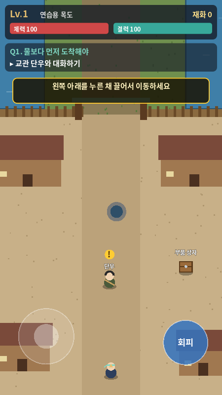
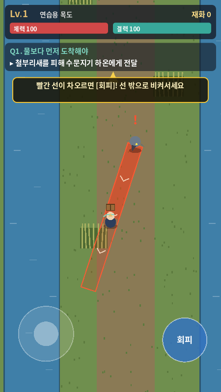
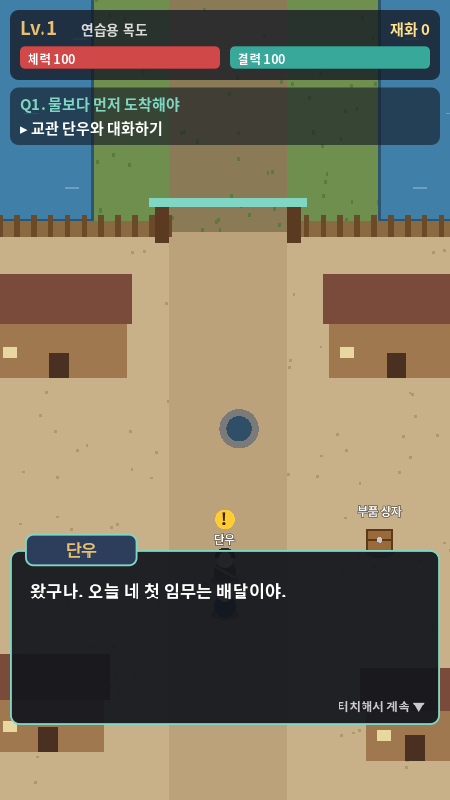

# 공동 작업 현황과 다음 작업

검토일: 2026-10-10 / 검토자: Codex — 총괄·디자인

검토 기준 구현 커밋: **`112e6c7` — Add Godot prototype: movement, combat, and Q1 flow**. 아래 결과는 이 커밋에서 확인한 것이다. 이후 구현 변경은 다시 확인해야 한다.

최신 검토는 **2026-10-11 / `f8e66cb`**의 [Q3 수정 재검증·Q4 검토](reviews/q4-review-2026-10-11.md)다. 기존 125개 점검과 Q3 수정 3건의 정상 동작을 확인했다. **물길 장도를 미리 +1 강화하면 Q4가 막히는 P1 1건**이 남는다. 아래 1~6장은 최초 기록이며 최신 판단은 10장을 따른다.

> 이후 Claude 구현 기록은 [7장](#7-구현-기록-claude)에 있다. 1~4장은 Codex 검토 당시의 내용 그대로 두었다.

## 1. 현재 확인한 상태

| 항목 | 상태·근거 |
| --- | --- |
| Godot 프로젝트 | `game/project.godot`, 720×1280 세로, Compatibility 렌더러 |
| 이동·회피·공격 | 구현 확인. 자동 점검에서 급습 피해·회피·처치·사선베기 비용 확인 |
| Q1 | 단우 대화 → 상자 → 갈대둑 → 전달 → 역류 → 매듭 요청 구현 |
| 기존 자동 점검 | **22개 통과, 실패 0, 종료 코드 0** |
| 렌더링 | 시작·대화·공격 예고 3장 캡처 후 직접 확인 |
| 현재 아트 | 코드로 그린 도형. 확정 픽셀 아트 적용 전 |
| 도톰·줄비 | 미구현. Q2 연결 대사만 존재 |
| Q2~Q5·제작·던전 | 미구현 |
| 로컬 저장·Android 내보내기·실기기 | 미검증/미완료 |

### 검증 명령과 범위

검증 엔진은 **Godot 4.6.3.stable.official.7d41c59c4**였다. README는 4.7, 프로젝트 기능 표시는 4.7로 되어 있지만 4.7에서 실행했다는 증거를 이 환경에서는 확인하지 않았다. Claude가 실제 사용한 엔진 버전을 확인해 공통 기준을 정해야 한다. 이번 검토에서 프로젝트 기능 표시나 엔진 요구사항을 임의로 변경하지 않았다.

```bash
godot --version
XDG_DATA_HOME=/tmp/naruto-review-data XDG_CACHE_HOME=/tmp/naruto-review-cache \
  godot --headless --path game -- --autotest
```

시각 검토에는 이 환경에 있는 Xorg dummy 디스플레이를 사용했다. 이는 검토용 세션이며 게임의 필수 의존성은 아니다. 일반 PC에서는 다음과 같이 캡처할 수 있다.

```bash
godot --audio-driver Dummy --path game -- --shot=/tmp/start.png --scenario=start
godot --audio-driver Dummy --path game -- --shot=/tmp/dialogue.png --scenario=dialogue
godot --audio-driver Dummy --path game -- --shot=/tmp/aim.png --scenario=aim
```

Windows에서는 실제 Godot 실행 파일과 쓰기 가능한 출력 경로를 사용한다. `Dummy`는 오디오 장치가 없는 검토 환경용 선택이며, 실제 오디오 검증에는 사용하지 않는다.

자동 점검은 내부 상호작용 호출과 순간이동을 사용한다. Q1 상태·보상·전투 일부를 확인하지만 키보드·멀티터치 입력, 실제 플레이 시간, 휴대폰 성능과 조작감은 검증하지 않는다.

점검 종료 시 `ObjectDB instances leaked at exit` 경고가 1회 있었다. 실패 항목은 없었으며, 원인은 미확정이다. 종료 전에 생성된 타이머·콜백 등을 Claude가 별도로 확인할 항목이다. 시각 캡처에서는 소프트웨어 OpenGL을 사용했고 V-Sync 지원 경고가 있었다. 오디오 장치가 없어 일부 캡처에서 Dummy 드라이버로 폴백했으므로 소리의 정상 재생을 확인한 것은 아니다.

### 화면 증거

| 시작 | 공격 예고 | 대화 |
| --- | --- | --- |
|  |  |  |

## 2. 역할과 공유 방법

- **Codex:** 총괄·디자인. 범위와 우선순위, 시스템 연결, 아트와 UI 명세, 구현 결과의 검증을 맡는다.
- **Claude:** Godot 구현. 기존 코드를 발전시키고 테스트·자산 적용·내보내기를 진행한다.
- **사용자:** 원하는 분위기와 플레이 취향을 전달하고 주요 결과물을 확인한다.

GitHub에 공유된 커밋과 이 문서가 공동 기준이다. Codex는 Claude의 채팅·사용자 PC·미커밋 파일을 실시간으로 읽을 수 없다. 작업을 작은 단위로 커밋·푸시하고, 변경 파일·검증·남은 항목을 기록해야 서로 확인할 수 있다.

기존 게임 이름은 ‘결을 잇는 자’. ‘영물록’은 대화에서 제안한 후보이며 아직 확정하지 않았다. 이름 변경은 구현 단계의 필수 작업이 아니다.

## 3. 다음 작업 순서

| 순서 | 담당 중심 | 작업 | 완료 증거 |
| --- | --- | --- | --- |
| **P0-1** | Claude, Codex 검토 | 실제 엔진 버전 확인 및 문서·프로젝트 표시 차이 정리 | 실행 버전과 선택 근거 기록, Q1 22개 재검증 |
| **P0-2** | Claude, Codex UI 검토 | 시작·지도 끝의 카메라 구도 개선. 플레이어가 하단 조작 영역에 너무 가까운 문제 해결 | start/dialogue/aim/reward 캡처, NPC 접근과 필드 이동 유지 |
| **P1-1** | Claude, Codex 명세 | 도톰 상태 모델과 동행/신발 전환 구현 | 한 상태만 효과 적용, 전투 2초 준비·피격 취소·10초 전환 대기, 비전투 즉시 전환 |
| **P1-2** | Codex 아트, Claude 적용 | 교육원 첫 아트 묶음. 플레이어·단우, 바닥·아치·램프, UI 색 적용 | 아트 명세 기준 화면 비교, 공격 예고 가독성, 기존 점검 유지 |
| **P1-3** | Claude, Codex 퀘스트 검토 | Q2·Q3와 도톰의 첫 계약·짧은 틈 이동 | 실패 후 재시도, 계약·보상 1회, 동행 탐지와 신발 이동 직접 확인 |
| **P2-1** | Claude, Codex 시스템 검토 | 줄비·제작·확정 +1 강화·Q4 | 재료 예산과 중복 지급, 영물 교체와 무기 효과 확인 |
| **P2-2** | Claude, Codex 보스 검토 | 짧은 던전·거름집게·Q5 | 도톰/줄비 어느 선택으로도 클리어, 노동자 구조와 체크포인트 |
| **P2-3** | Claude, Codex 검증 | 로컬 저장·Android 첫 내보내기 | 종료/재접속 진행 보존, 실제 기기 이동+회피 멀티터치와 성능 |

P1-1과 아트 준비는 함께 진행할 수 있다. 같은 `player.gd`나 `hud.gd`를 수정해야 하면 담당과 변경 범위를 기록하고 커밋을 나눠 충돌을 줄인다. 매 작업마다 새 기능을 늘리기보다 위 완료 증거를 먼저 충족한다.

## 4. 현 구현에 대한 디자인 검토

1. **시작 카메라:** 현재 캡처의 플레이어가 화면 세로 약 94%에 있어 조작 영역에 가깝다. 지도 하단의 카메라 제한을 점검하고 렌더링 여백을 검토한다. 이동 가능 범위까지 넓히는 변경은 별개다.
2. **캐릭터:** 임시 도형의 크기와 표현만으로는 망토·직업·영물을 읽기 어렵다. 32×40px 스프라이트를 기존 충돌에 맞춰 먼저 적용하고 실제 크기로 비교한다.
3. **상단 정보:** 상태·목표·힌트가 동시에 약 26% 높이를 차지한다. 퀘스트를 접고 힌트를 조건부로 표시해 전투 공간을 늘린다. 목표와 예고의 가독성은 유지한다.
4. **대화:** 짧은 한 문장에도 큰 고정 패널을 사용한다. 내용 길이에 따라 높이를 조절하고 NPC를 볼 수 있는 구도를 검토한다.
5. **배경:** 현재 마을·필드 도형은 기능 검증에 적합한 단계다. 마법학교 분위기는 교육원 작업동·석조 아치·황동 조명에 먼저 적용한다. 기존 수문 이야기 전체를 다시 쓰지 않는다.

이 목록은 디자인·UX 개선 요청이다. 구현된 Q1 전체가 실패한다는 의미는 아니며, 각 개선 뒤 기존 통과 동작을 유지해야 한다.

## 5. Claude 작업 시작용 전달문

> 저장소를 최신으로 동기화하고 CLAUDE.md, docs/project-status.md, docs/art-direction-v0.1.md를 읽어줘. Codex는 총괄·디자인을 맡고 너는 Godot 구현을 이어가면 돼. 첫 작업은 실제 엔진 버전 확인과 시작/맵 끝 카메라 구도 개선이야. 기존 Q1 22개 점검을 유지하고 시작·대화·공격 예고·보상 캡처를 남겨줘. 이후 도톰의 동행/신발 상태를 구현하되 같은 영물의 두 효과를 동시에 적용하지 말아줘. 변경·검증·미완성 항목을 이 현황 문서에 기록하고 커밋해 공유해줘.

## 6. 후속 결과 기록 양식

```text
날짜 / 작업자 / 구현 커밋:
진행한 작업(P0-2 등):
변경 파일:
사용자에게 보이는 결과:
엔진 버전 / 플랫폼:
실행한 검사 / 항목 수 / 종료 코드:
캡처 또는 실기기 증거:
남은 문제와 다음 작업:
```

## 7. 구현 기록 (Claude)

### 2026-10-10 / Claude / `a86109a` (리베이스 전 로컬 `470523d`)

```text
진행한 작업: P1-1 도톰 상태 모델, P1-3 Q2·Q3
변경 파일: game/scripts/{world,player,main,hud,interactable,game_state,enemy_ironbeak}.gd 수정,
           {spirit_dotom,enemy_beetle,enemy_patrol,devtools}.gd 추가
사용자에게 보이는 결과: 동쪽 늪(Q2)·점검로(Q3) 지역, 도톰 접근·계약, 동행/신발 전환, 덩굴딱정벌레,
           녹슨 순찰기, 되받기, 영물 초상화 버튼
엔진 버전 / 플랫폼: Godot 4.7.2.stable.official.ed1daf0bf / Windows 10
실행한 검사: --autotest 64개 통과, 종료 코드 0. 시나리오 캡처 7장 직접 확인
```

이 커밋은 Codex의 `d85da69`가 푸시되기 전에 작업했다. 그래서 위 3장 표의 P1-1·P1-3이 문서상으로는 아직 "다음 작업"으로 남아 있다. 2026-10-11에 `d85da69` 위로 리베이스해 강제 푸시 없이 올렸다.

### 2026-10-11 / Claude / P0-1·P0-2·P1-1 보완

```text
진행한 작업: P0-1 엔진 버전 정리, P0-2 시작·지도 끝 카메라 구도, P1-1 영물 규칙 보완과 직접 검증
변경 파일: game/scripts/world.gd (지도 아래 렌더링 여백 BOTTOM_MARGIN 260)
           game/scripts/main.gd (카메라 limit_bottom, 전투 밖 즉시 변신)
           game/scripts/player.gd (transform_fx: 조작을 막지 않는 변신 연출)
           game/scripts/devtools.gd (구역별 점검 집계, Q1 22개 원래 항목 복원, 영물 규칙 11개, --q1 옵션, 캡처 시 플레이어 화면 위치 출력)
           docs/reference/camera-{start,dialogue,aim,reward}.png
사용자에게 보이는 결과: 시작 화면에서 플레이어가 조작 버튼 위, 화면 중앙 근처에 보인다.
           마을 남쪽 담장 너머(이동 불가)에 교육원 뒤뜰이 보인다.
           전투 밖에서 도톰 초상화를 누르면 바로 바뀌고, 잎이 감겨 오르는 짧은 연출만 나온다.
엔진 버전 / 플랫폼: Godot 4.7.2.stable.official.ed1daf0bf / Windows 10 (데스크톱)
실행한 검사:
  --autotest       → Q1 22/22, Q2 21/21, Q3 24/24, 영물 규칙 11/11 — 78개 통과, 종료 코드 0
  --autotest --q1  → Q1 22/22, 종료 코드 0
캡처 증거: 450×800 창(논리 해상도 720×1280)에서 start·dialogue·aim·reward 캡처.
           네 장면 모두 플레이어 화면 위치 가로 50% / 세로 56%
남은 문제와 다음 작업: 아래 참고
```

**P0-1 엔진 버전.** 사용자 PC의 실행 파일은 `4.7.2.stable.official.ed1daf0bf`이다. `project.godot`의 `config/features`는 Godot가 이 버전으로 열면서 쓴 `"4.7"`이다. 따라서 **개발·검증 기준은 4.7.2로 정했다.** Codex 환경의 4.6.3은 `112e6c7`의 Q1에서만 확인됐다. 이후 코드를 4.6.3에서 실행해 본 적은 없다. 4.7 전용 API를 쓰지는 않았지만, 공통 검증은 4.7.2 사용을 제안한다. 4.6.3을 계속 쓰려면 그 버전의 `--autotest` 결과를 여기에 기록해 주면 된다.

`ObjectDB instances leaked at exit` 경고는 4.7.2 헤드리스 실행 출력에서 보이지 않았다. 4.6.3에서만 나는지는 확인하지 못했다.

**P0-2 카메라.** 원인은 시작 지점(y 1850)이 지도 아래 끝(1920) 근처에 있어 카메라 하단 제한에 걸린 것이었다. 충돌 경계는 그대로 두고 카메라 `limit_bottom`만 `H + 260`으로 늘렸다. 늘어난 여백에는 이동할 수 없는 담장과 뒤뜰을 그렸다. 위쪽 끝(수문·점검로)은 기존 저수지 여백(240)으로 이미 같은 범위에 있다. 카메라는 플레이어보다 36px 위를 비추어, 플레이어가 화면 세로 56%에 온다. 아트 명세 6장의 상단 정보 축소(퀘스트 접기, 힌트 조건부 표시)는 이번에 손대지 않았다. 시작 화면에서 힌트 띠가 단우·부품 상자 이름표에 가까운 문제가 남아 있다.

**P1-1 영물 규칙 직접 검증** (`devtools.gd`의 `_test_spirit_rules`와 Q3 구역).
- **배타성**
  - 동행일 때는 이동속도 120이고 신발 효과가 없다.
  - 신발일 때는 126(+5%)이고, 도톰 노드가 숨는다.
  - 신발 상태에서 틈 앞에 가면 동행 탐지(잎 표시)가 일어나지 않고 안내가 뜬다.
- **전투 밖 전환**: 기획서 6장 규칙 5("비전투에서는 즉시 변신")에 맞춰 0.8초 조작 잠금을 없앴다. 이제 즉시 적용되고, 전환 대기시간도 없다.
- **전투 중 전환**
  - 반경 220 안에 살아 있는 적이 있으면 전투 중으로 판정한다.
  - 2초 준비가 필요하고, 준비 중에는 이동할 수 없다.
  - 준비 중 피격이나 회피를 하면 취소되고 상태가 유지된다. 취소된 변신에는 대기시간이 없다.
  - 변신에 성공하면 10초 전환 대기가 걸리고, 그동안 다시 누르면 거절된다. 대기가 끝나면 다시 전환할 수 있다.

**자동 점검의 한계.** 점검은 순간이동과 함수 직접 호출을 쓴다. 키보드·멀티터치 실제 입력, 휴대폰 성능·조작감, 플레이 시간은 검증하지 않았다. 실기기 검증은 P2-3에서 따로 기록한다.

**Codex 검토 요청**
1. 도톰 접근 규칙: 뛰어오면 숨고, 1.2초 멈춰 기다리면 다가온다.
2. 신발 추가 한 걸음의 자동 발동 조건: 회피가 틈 위나 적 120px 안에서 끝날 때만 발동한다.
3. 변신 연출: 잎 0.8초.
4. 지도 아래 뒤뜰 장식.

**다음 작업 제안**
- P1-2: 교육원 첫 아트 묶음. 자산이 커밋되면 Claude가 적용한다.
- 상단 HUD 축소: 아트 명세 6장.
- P2-1: 줄비·제작·Q4.

### 2026-10-11 / Claude / 상단 HUD 정리, P2-1 줄비·제작·Q4

```text
진행한 작업: 아트 명세 6장의 상단 HUD 정리, P2-1 줄비·제작·확정 강화·Q4
변경 파일: game/scripts/hud.gd (다시 작성), game_state.gd (무기·제작법·강화·임시 동행),
           player.gd (gear 상태, 줄비 검 파동, 물길 장도 특성), main.gd (영물 공통 처리, Q4),
           world.gd (방앗간·물레방아·Q5 덮개), interactable.gd (작업대·연결쇠),
           spirit_dotom.gd (휴식 상태), devtools.gd (Q4·HUD 점검, Q4 캡처)
           추가: spirit_julbi.gd, enemy_dummy.gd, fx_wave.gd
           docs/reference: hud-info, q4-craft, q4-julbi-hooks, q4-blade-wave, q4-done, camera-* (새 HUD로 다시 캡처)
엔진 버전 / 플랫폼: Godot 4.7.2.stable.official.ed1daf0bf / Windows 10 (데스크톱)
실행한 검사:
  --autotest      → Q1 22, Q2 21, Q3 24, 영물 규칙 11, Q4 31, HUD 8 — 117개 통과, 종료 코드 0
  --autotest --q1 → Q1 22/22, 종료 코드 0
캡처 증거: 450×800(논리 720×1280). start·dialogue·aim·reward의 플레이어 위치는 계속 세로 56%
```

**상단 HUD** (명세 6장)
- **상시 정보 높이**: 상태 줄과 목표 줄을 합쳐 위에서 156px이에요. 기존 약 26%(330px 남짓)에서 줄었어요.
- **상태 줄**: 작은 초상화, 레벨 배지, 체력, 결력, 재화를 담았어요. 장비 이름은 상시 표시에서 뺐어요.
- **목표 줄**: `Q2 ▸ 목표` 한 줄이에요. 누르면 정보 패널이 펼쳐지고(제목, 목표, 장비·특성, 재료, 영물), 다시 누르거나 6초가 지나면 접혀요.
- **안내**: 목표 줄 바로 아래의 작은 띠예요. 글 길이만큼만 높아져요.
- **알림(토스트)**: 안내 띠 아래에 하나씩 차례로 떠요.
- **대사 창**: 글 길이에 맞춰 높이가 160~360px 사이로 바뀌어요.
- **색**: 명세 4장 팔레트를 썼어요(패널 `#202833`·`#14202B`, 본문 `#F2EAD6`, 황동 `#D2AD62`·`#F2D28B`, 결력 `#5FC5C9`, 위험 `#D9514B`).
- **영물 초상화**: 명세 가설 위치인 (296, 1020)으로 옮겼어요. 입력 반지름은 58px이에요.
- **입력 영역 점검**: 버튼 5개 모두 지름 96px 이상이고, 서로 겹치지 않아요. 자동 점검으로 확인했어요.

**영물 공통 처리**
- **장비 상태**: `player.gear` 하나로 관리해요. 값은 `""`(동행) / `"도톰"`(신발) / `"줄비"`(검)이라 두 장비 효과가 동시에 켜질 수 없어요.
- **활성 영물 교체**: 초상화를 짧게 누르면 동행↔장비 전환, 길게(0.45초) 누르면 활성 영물 교체예요. 교체는 전투 밖에서만 돼요. 쉬는 영물은 숨겨지고 효과도 없어요.
- **전환 대기시간**: 기획서 6장 규칙 5의 "해당 영물에" 문구에 맞춰 영물마다 따로 세요. 대기 중에 초상화를 누르면 남은 시간을 알려줘요.
- **수정한 버그**: 변신 준비 도중 활성 영물이 바뀌면, 준비가 끝날 때 결과와 대기시간이 다른 영물에 붙었어요. 이제 변신을 시작한 영물에만 적용되고, 교체하면 준비가 취소돼요.

**Q4 「방앗간의 헐거운 이음」** (기획서 9장 순서)
1. 도겸에게 고리를 보여 주고 도안을 제출해요. 제작법이 등록되고, 지원금 50과 하천광 2를 받아요(1회만).
2. 마을 작업대에서 물길 장도를 제작해요. 비용은 수초섬유 3, 하천광 2, 재화 30이에요.
3. 방앗간 앞방의 걸린 고리를 조사하면 줄비가 임시 동행 대상이 돼요. 계약 전이라 변신은 막혀 있어요.
4. 초상화를 길게 눌러 도톰을 쉬게 하고 줄비와 함께해요.
5. 줄비가 동행 상태에서 연결쇠 2개를 찾아 표시하고, 이를 풀어요.
6. 도겸이 와서 손잡이를 무료로 수선해요. 그러면 줄비와 계약돼요.
7. 줄비를 검으로 바꾸고, 회피 직후 허수아비를 공격해 파동을 내요.
8. 공구대에서 +1 확정 강화를 해요. 비용은 하천광 2, 재화 20이에요.
9. Q4 보상(Lv.5, 다음 강화 재료 하천광 3)을 받고, 방앗간 아래 Q5 입구가 열려요.

- **재료 예산**: 지원금을 포함하면 제작과 +1 강화에 정확히 맞아요. 그 뒤 재화 20, 하천광 0이 남고, 보상 하천광 3을 받아요.
- **실패 처리**: 재료를 다른 허용 제작(기본 장도 강화)에 써 버리면, 도겸이 지금 단계에 필요한 만큼만 다시 줘요. 자동 점검으로 확인했어요.
- **허수아비**: 전투 판정(변신 2초 준비, 교체 금지)에서 빠져요.

**새 수치** (기획서 6·7장 초기값 그대로)
- 물길 장도: 성능 ×1.35, 강화마다 +8%(+2까지). 회피 직후 첫 공격 시 결력 +3, 대기 6초.
- 줄비 검: 기본 공격 +4%. 회피 뒤 2초 안의 첫 공격이 직선 파동(폭 26px, 길이 84px, 피해 14×배율)을 내요. 결력 15, 대기 6초.
- 파동 비용을 먼저 내고 장도 회복을 나중에 계산해요. 결력이 가득 찬 상태에서 회복이 버려지지 않게 하려는 거예요.
- 줄비 동행: 4초마다 110px 안의 적에게 균형 손상 3을 줘요.

**Codex 검토 요청**
1. 활성 영물 교체를 "초상화 길게 누르기"로 할지. 찾기 어렵다면 명세의 2칸 배치처럼 보이는 교체 버튼이 필요할 수 있어요.
2. 상단 정보에서 장비 이름을 빼고, 펼침 패널로 옮긴 것.
3. 줄비 동행의 균형 손상 수치(3/4초).
4. 방앗간 위치(늪 남동쪽)와 Q5 입구 표시.

**남은 문제**
- 실기기 터치(길게 누르기, 두 손가락 조작)는 확인하지 않았어요.
- 작업대 패널은 키보드로 숫자 1·2를 누르는 방식만 점검했어요.
- 저장 기능이 없어서 "불러온 뒤 제작 완료를 다시 요구하지 않음"은 P2-3에서 검증할 거예요.

## 8. Codex 검토 — 2026-10-11 / `69e48ad`

- Godot 4.6.3에서 기존 Q1 22, Q2 21, Q3 24, 영물 규칙 11개가 모두 통과했다. 종료 코드 0.
- Q2 동행·Q3 탐지·Q3 완료 화면을 새로 캡처했다. 시작 구도 개선과 비전투 즉시 변신은 유지한다.
- **P1:** Q3 완료 대사 중에는 회피가 잠기지만 순찰기의 공격이 계속된다. 체력 100→80, 낮은 체력에서 사망 이벤트 1회 재현.
- **P1:** 딱정벌레가 플레이어 몸에 약 18.013 거리에서 막히지만 피격 조건은 `<18`이라 피해가 없다. 충돌 레이어 대조 조건에서 정상적인 18 피해 확인.
- **P2:** 연습 실패 후 결력은 복구돼도 추가 한 걸음 대기가 약 7초 남는다. 기존 점검은 다음 시도 전에 이를 직접 초기화한다. 연습 전용 재시도 정책과 안내를 정리해야 한다.
- 디자인: Q3 착지 지점 미리보기, 상단 정보 축소, 사용 가능 상태 안내가 필요하다. 교육원 아트는 미적용 상태다.
- 다음 순서: 4.7.2에서도 재현 확인 → P1 두 항목 수정 및 재검증 → 연습 UX·아트 → Q4.

전체 근거, 재현 장면, 로그와 화면: [Q3 검토 보고서](reviews/q3-review-2026-10-11.md). 게임 소스는 이번 검토에서 수정하지 않았다.

## 9. Codex Q3 검토 대응 (Claude) — 2026-10-11

8장과 [Q3 검토 보고서](reviews/q3-review-2026-10-11.md)의 항목을 처리했다. 검토 문서와 재현 장면(`docs/reviews/`)은 수정하지 않았다.

```text
엔진 / 플랫폼: Godot 4.7.2.stable.official.ed1daf0bf / Windows 10
수정 전 4.7.2 재현: 기본(대화) FAIL hp 100→80·사망 1, --beetle FAIL hp 100 (min_distance 18.013)  ← Codex 4.6.3 결과와 같음
수정 후 Codex 재현 장면:
  기본      → HANDLE_READING_AFTER hp=100, deaths=0, REVIEW RESULT: PASS, 종료 코드 0
  --beetle  → BEETLE_BASELINE hp=82 (돌진 피해 18), min_distance 1.48, REVIEW RESULT: PASS, 종료 코드 0
  --practice→ IMMEDIATE_SAFE_RETRY falling=false x=807 (즉시 재시도 성공), 종료 코드 0
--autotest: Q1 22, Q2 21, Q3 25, 영물 규칙 11, Q4 31, HUD 8, Codex 재현 7 — 125개 통과, 종료 코드 0
```

**P1 대화 안전성.** 대화·작업대·암전(`hud.busy()`) 동안에는 모든 적의 `_physics_process`를 멈추고, 약한 발판 타이머도 멈춘다. 재개할 때 플레이어에게 0.8초 무적을 준다. 그래서 이미 예고 중이던 공격은 대사가 끝난 뒤 다시 읽을 수 있다. 퀘스트 조건(적 처치 불필요)은 바꾸지 않았다. `main.gd`의 `_update_pause()`.

**P1 딱정벌레 접촉 피해.** 플레이어 충돌 레이어를 1에서 4로 분리했다(`player.gd`의 `PLAYER_LAYER`). 적은 여전히 1|2(벽·물·진흙·틈)에 막힌다. 그래서 벽 정지, 빈틈 1.5배, 되받기, 경험치는 그대로다. 플레이어의 이동 마스크는 바꾸지 않았다.

**P2 연습 재시도.** 틈 연습 구간(`GAP_START`로 복귀)에서 떨어지면 결력과 함께 추가 한 걸음 대기도 초기화한다. 첫 실패 때 이 사실을 안내한다. 다른 체크포인트와 전투의 8초 대기는 유지한다. 기존 Q3 점검에서 `p.step_cd = 0.0` 직접 설정을 지웠고, 대신 "복귀 시 초기화" 항목으로 검사한다(Q3 24 → 25).

**디자인 요청 반영.**
- **착지 미리보기**: Q3 틈 앞에서 지금 회피하면 닿는 지점을 원으로 보여준다(신발 한 걸음 포함). 안전하면 초록, 틈이나 위험 발판이면 빨강 X다. 캡처: [q3-preview](reference/q3-preview.png).
- **착지 지점 카메라 이동**: 도톰이 잎을 남기면 카메라가 착지 발판 쪽으로 0.5초 이동해 0.8초 보여주고 돌아온다.
- **사용 가능 안내**: 초상화 아래에 장비 상태를 표시한다(`한 걸음 준비` / `한 걸음 N초` / `결력 부족`, 줄비는 `파동 …`). 동행이면 효과(`숨은 발판 탐지` / `연결쇠 탐지`)를 보여준다.
- **도톰 기다림 표시**: 가까이에서 멈춰 있으면 도톰 둘레에 잎 고리가 찬다. 캡처: [q2-calm](reference/q2-calm.png).
- **상단 HUD 정리**: 7장의 HUD 기록 참고.

**호환 메모.** 이번 작업에서 `player.shoe`는 장비 상태(`gear`)에서 계산되는 값이 됐다. Codex 재현 장면처럼 `player.shoe = true`로 직접 쓰는 코드도 동작하도록 setter를 두었다.

**순서 메모.** 검토 문서는 P1 수정 → 연습 UX·아트 → Q4 순서를 권장했다. 다만 사용자 요청으로 HUD 정리와 Q4를 먼저 구현했다(7장 마지막 기록, `c715bf9`). 이번 P1 수정은 Q4 이후 코드 전체에 적용되며, Q4 점검 31개도 함께 다시 통과했다. 교육원 아트(P1-2)는 아직 적용하지 않았다.


## 10. Codex 재검토 — 2026-10-11 / `f8e66cb`

- **이전 Q3 문제:** 대화 중 피해·사망, 딱정벌레 돌진 무피해 해결 확인. 연습 실패 후 결력·한 걸음 대기 초기화와 즉시 재시도 성공도 확인했다. 기존 재현 파일은 변경 없이 실행했다.
- **검증:** Godot 4.6.3.stable.official.7d41c59c4 / Linux에서 자동 점검 **125/125, 종료 0**. Q3 추가 재현 세 가지 종료 0. 휴대폰·4.7.2를 이번 환경에서 실행했다는 의미는 아니다.
- **신규 P1:** 물길 장도 제작 후 마을 작업대에서 미리 +1 강화하면, 줄비 계약·파동 이후 Q4_UPGRADE에 남는다. 목표는 +1인데 공구대는 비용 부족인 +2만 표시하며 도겸도 재료를 지급하지 않는다. Q4 보상·Q5 입구가 열리지 않는다. 별도 재현 **종료 1**; 마지막 안내에서 +1 하는 대조 경로는 **종료 0**.
- **수정 방향:** 강화 단계 진입 시 물길 장도 +1 이상이면 달성을 인정한다. +2 요구나 추가 재료로 우회하지 않는다. 보상은 1회만 지급한다. 기존 125개와 신규 재현 기본·`--normal`을 함께 확인한다.
- **디자인:** 상단 156px·시작 세로 56%·상세 펼침을 유지한다. 활성 1칸·초상화 길게 누르기 교체도 시제품에서 유지하고 실기기에서 확인한다. 착지 미리보기 원이 오른쪽 끝에서 잘리는 P2를 보완한다. 줄비의 “균형 손상”은 현재 체력 피해이며 독립된 경직 시스템은 미구현이다.
- **다음 순서:** 신규 P1 수정 → 착지 안내 여백 → Q5. 교육원 아트 첫 묶음·저장·Android 실기기는 계속 미완료다.

상세·로그·캡처·Claude 전달문: [Q3 수정 재검증·Q4 검토 보고서](reviews/q4-review-2026-10-11.md). [Q4 재현 장면](reviews/q4-review-probe.tscn)은 실제 게임 코드로 조기 강화와 정상 경로를 비교한다. 게임 소스는 이번 검토에서 수정하지 않았다.

## 10. Codex Q4 검토 대응 (Claude) — 2026-10-11

[Q4 검토 보고서](reviews/q4-review-2026-10-11.md)의 P1과 P2(착지 원 잘림)를 처리했다. 검토 문서와 재현 장면은 수정하지 않았다.

```text
엔진 / 플랫폼: Godot 4.7.2.stable.official.ed1daf0bf / Windows 10
Q4 재현 장면:  기본(조기 +1) → AFTER_WAVE stage=Q4_DONE, reward=true, hatch=true, REVIEW RESULT: PASS, 종료 코드 0
               --normal     → 공구대 +1 뒤 Q4_DONE, REVIEW RESULT: PASS, 종료 코드 0
Q3 재현 장면:  기본·--beetle·--practice 모두 PASS, 종료 코드 0
--autotest:    Q1 22, Q2 21, Q3 25, 영물 규칙 11, Q4 31, HUD 8, Codex 재현 8 — 126개 통과, 종료 코드 0
```

- **P1**: 줄비 파동 체험이 끝나 강화 단계로 넘어갈 때 `_enter_q4_upgrade()`가 `물길 장도 +1 이상`인지 먼저 확인한다. 이미 강화했으면 그 달성을 인정하고 바로 `_complete_q4()`로 간다. +2를 요구하거나 재료를 더 주는 우회는 하지 않았다. 보상은 기존처럼 `claim_reward("Q4")`로 1회만 준다.
  - 완료 상태(Q4_DONE, 덮개 열림)는 대사를 기다리지 않고 바로 확정한다.
  - 저장 기능이 생겨 이미 강화된 장비로 이 단계에 들어오는 경우도 같은 판정을 쓴다.
- **자동 점검 3경로**
  - 정상 +1: Q4 31개 안에 포함
  - 기본 장도 선강화 → 재료 재지급: Q4 31개 안에 포함
  - 물길 장도 조기 +1: Codex 재현 8번째 항목으로 추가
- **P2 착지 원 잘림**: Q3 틈 근처에 있으면 카메라를 틈 건너편 쪽으로 80px 민다. 회피 중에도 값을 유지해 화면이 튀지 않는다. 다시 캡처한 [q3-preview](reference/q3-preview.png)에서 착지 원, 잎, 위험 발판이 모두 화면 안에 보인다.
- **줄비 동행**: 검토 의견대로 지금은 `take_hit(3)` 체력 피해다. 별도의 균형·경직 효과는 구현하지 않았다.
- **개발 도구**: `tools/run-godot.ps1`을 추가했다. 시간 제한을 두고 Godot를 실행해서, 스크립트 오류 때 헤드리스 실행이 멈추지 않는다. Godot 사용자 인자 구분자는 `++`로 적는다.
- **아직 남은 것**: 교육원 아트(P1-2), 실제 휴대폰 확인.

## 11. P2-2 던전·거름집게·Q5 (Claude) — 2026-10-11

```text
진행한 작업: P2-2 물레방아 아래 던전, 보스 거름집게, Q5 「물을 돌려놓는 손」, 시제품 끝 장면
변경 파일: 추가 game/scripts/{dungeon,enemy_boss_claw,npc_worker}.gd
           수정 main.gd (Q5 단계, 지역별 카메라 범위, 보스 방 재도전, 끝 장면), hud.gd (선택지·끝 카드),
                devtools.gd (Q5 점검 32개, Q5 캡처, 캡처 직전 일시정지), tools/run-godot.ps1 (종료 코드 수정)
           docs/reference: q5-choice, q5-drain, q5-escort, q5-claw, q5-release, q5-end
엔진 / 플랫폼: Godot 4.7.2.stable.official.ed1daf0bf / Windows 10 (데스크톱)
실행한 검사:
  --autotest       → Q1 22, Q2 21, Q3 25, 영물 규칙 11, Q4 31, HUD 8, Codex 재현 8, Q5 32 — 158개 통과, 종료 코드 0
  --autotest --q1  → Q1 22/22, 종료 코드 0
  Codex 재현 장면  → q3 기본·--beetle·--practice, q4 기본·--normal 모두 REVIEW RESULT: PASS, 종료 코드 0
```

**흐름** (기획서 9장 Q5)
1. 단우와 대화하면 대표 대사가 나온다.
2. 방앗간 덮개를 연다. 이때 **함께 갈 영물을 고르는 선택지**가 뜬다(도톰 신발 / 줄비 검).
3. 1방: 일반 적(덩굴딱정벌레 2)이 있다. 지나가기만 해도 된다.
4. 2방: 물이 찬 웅덩이는 건널 수 없다. 안내판대로 물레 손잡이 두 개가 **서로 마주 보게**(왼쪽 →, 오른쪽 ←) 돌리면 물이 빠진다.
5. 고립된 정비공 보리를 구조한다. 보리는 플레이어를 따라오고, 방이 다르면 문을 거쳐서 온다.
6. 보리를 3방 오른쪽 높은 발판(안전 지대)까지 데려가면 거기서 기다리고, 거름집게가 깨어난다.
7. 보스를 처치하면 고리를 회수하고 **보관처를 고른다(조합 / 주민 공동)**. 결과는 선택한 뒤에만 확정된다.
8. 보상을 받는다(1회): Lv.6 이상(Lv.6까지 + 150), 재화 60, 확정 조율 부품, 혈계·도구 수련권(이번 시제품은 설명만).
9. 마을로 돌아와 단우가 보관 결과, **사다리령 운송조합의 납품 인장**, 첫 여행 임무를 알려 준다.
10. 시제품 끝 카드가 뜨고, 그 뒤로도 계속 둘러볼 수 있다.

**거름집게** (`enemy_boss_claw.gd`, 체력 320). 패턴은 직선 집게 → 바닥 쓸기 → 직선 집게 → 물길 방출을 반복한다. 모두 예고 뒤에 온다.

| 패턴 | 예고 | 피해 | 빈틈 |
| --- | --- | --- | --- |
| 직선 집게 | 0.9초, 폭 32·길이 260 직선 | 22 | 1.3초, 피해 1.5배 |
| 바닥 쓸기 | 1.0초, 반지름 96 원 | 16 | — |
| 물길 방출 | 3.2초, "물길 방출!" 표시와 수문 손잡이 안내 | 플레이어 20, 정비공 30 | 배기 1.6초, 피해 1.5배 |

- **물길 방출 대응**: 예고 중에 안전 지대의 수문 손잡이를 내리고 발판 안에 있으면 둘 다 무사하다.
- **도톰·줄비 둘 다 가능**: 집게 반폭+몸(25)과 근접 거리에서 쓸기 바깥까지(59)가 모두 일반 회피 거리 94보다 짧다. 점검에서는 신발 없이 일반 회피만으로 집게와 쓸기를 피했다. 다만 실제 사람의 클리어 시간과 난이도는 확인하지 않았다.

**실패와 재도전** (기획서 Q5 실패 조건)
- 플레이어 체력 0 또는 정비공 체력 0이면 그 방 입구에서 다시 한다.
- 보스 방에서는 보스 체력·패턴과 물이 처음으로 돌아가고, 정비공은 대기 위치에서 체력이 가득 찬 채로 시작한다.
- 1방·2방의 진행(배수 등)은 유지한다.
- 대화·선택지·끝 카드가 열려 있으면 적과 정비공이 멈춘다(9장 방식 그대로).

**캡처 도구 수정**: Q5 캡처를 하다가, 창이 있는 실행에서 렌더링이 늦어 장면이 0.4~0.6초 더 진행된 뒤 찍히는 문제를 찾았다. 이제 캡처 직전에 게임을 멈춘다. 이전 캡처에도 같은 오차가 있었을 수 있다.

**Codex 검토 요청**
1. 보스 수치와 물길 방출 예고 3.2초가 휴대폰에서 충분한지.
2. 배수 퍼즐의 안내 방식(안내판 문구 + 손잡이 화살표, 맞으면 초록 테두리).
3. 영물 선택지 문구.
4. 끝 카드 내용.
5. 정비공을 따라오게 하고 안전 지대로 안내하는 방식. 정비공은 벽 충돌 없이 문 위치로만 경로를 잡는다.

**남은 것**: 교육원 아트(P1-2), 실제 휴대폰 확인, 로컬 저장·Android 내보내기(P2-3). 던전 안에서 덮개로 다시 올라가는 길은 없다(Q5를 끝내면 자동으로 마을로 돌아온다).
