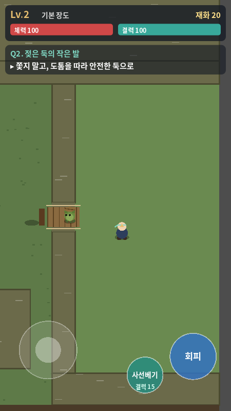
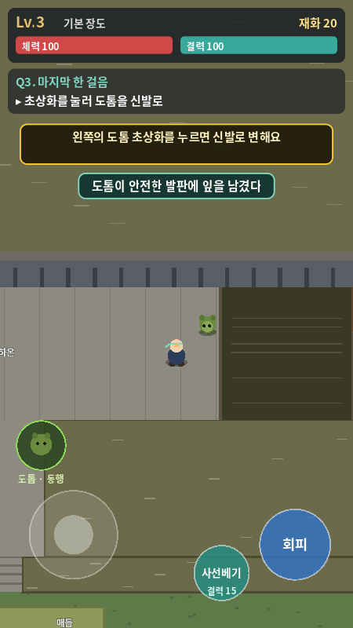
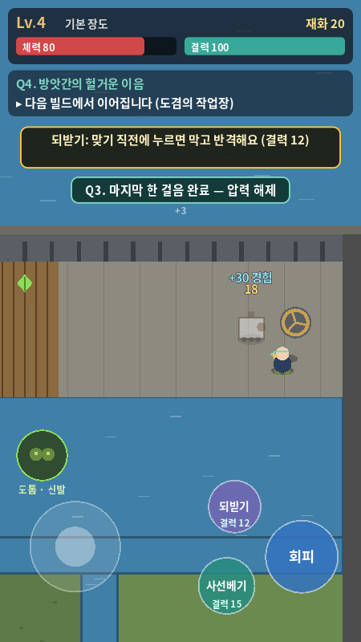

# Q1~Q3 검토 — 2026-10-11

검토자: Codex / 총괄·디자인

대상 구현: **`69e48ad`**, 이전 기능 커밋 `a86109a` 포함.

**결론:** 퀘스트와 영물 상태의 기본 흐름은 통과했다. 다만 기존 점검 밖에서 재현한 P1 문제 2개를 수정한 뒤 Q4로 진행하는 것을 권장한다. 추가로 Q3 연습 재시도와 화면 안내를 다듬어야 한다.

## 1. 검증 결과와 범위

| 검증 | 결과 |
| --- | --- |
| 기존 `--autotest` | **Q1 22/22, Q2 21/21, Q3 24/24, 영물 규칙 11/11. 총 78개 통과, 종료 코드 0** |
| 추가: Q3 완료 대화 안전성 | **실패, 종료 코드 1**. 대화를 읽는 동안 체력 100→80. 낮은 체력에서는 사망 이벤트 1회 |
| 추가: 딱정벌레 돌진 접촉 피해 | **실패, 종료 코드 1**. 돌진 접촉 중 체력 100 유지. 물리 충돌만 분리한 대조 조건에서는 100→82 |
| 추가: 연습 실패 직후 재시도 | 관찰 완료. 결력 100으로 복구돼도 추가 한 걸음 대기 약 6.87초가 남고, 즉시 재시도하면 다시 추락 |
| 실행 화면 | 도톰 안내(Q2), 탐지 완료(Q3), Q3 완료 후 화면을 새로 캡처해 확인 |

실행 엔진은 **Godot 4.6.3.stable.official.7d41c59c4 / Linux**이다. Claude의 개발 기준은 문서상 **4.7.2.stable.official.ed1daf0bf / Windows**다. 4.6.3에서도 이번 구현의 기존 78개 점검이 통과한다는 근거를 추가했다. 이는 모든 4.7 기능·내보내기가 호환된다는 뜻은 아니다. 추가 재현 장면은 Claude 환경의 4.7.2에서도 실행해 결과를 비교한다.

실기기 멀티터치·Android 내보내기·휴대폰 성능·실제 플레이 시간은 이번에 검증하지 않았다. 시각 검토는 450×800 출력과 720×1280 논리 해상도, 소프트웨어 OpenGL로 수행했다. 기존 점검과 추가 재현 모두 위치·단계 준비에는 직접 호출을 사용하며, 피해·충돌·대화·변신은 원본 게임 로직을 실행한다.

게임 본체의 소스는 수정하지 않았다. 이 검토는 문서·캡처·재현용 장면을 추가한다.

## 2. P1 — Q3 완료 대화 중 순찰기 공격으로 피해와 사망

**위치:** `game/scripts/main.gd` 293~294, 637~659 / `game/scripts/player.gd` 243~267 / `game/scripts/enemy_patrol.gd` 62~98.

**재현:** 순찰기가 살아 있고 오른쪽을 보는 동안 압력 손잡이를 돌린 뒤, 완료 대사를 넘기지 않고 읽는다. 재현 장면은 플레이어를 `(1010, 118)`에 놓아 손잡이가 정상 상호작용 범위 안에 있게 한다.

**관찰:**

```text
HANDLE_IN_RANGE=true
HANDLE_READING_START hp=100.0 dialogue=true locked=true dodge_allowed=false
HANDLE_READING_AFTER hp=80.0 dialogue=true locked=true
HANDLE_LOW_HP_READING deaths=1 dialogue=true dead=false
```

마지막 `dead=false`는 사망하지 않았다는 뜻이 아니다. 사망 이벤트가 1회 발생하고 재시작한 뒤에도 대화가 남아 있는 상태다.

**원인:** 대화는 플레이어의 이동·회피·기술을 잠그지만, 순찰기의 공격과 `take_damage()`는 계속 실행된다. Q3는 적을 처치하지 않고 회피·우회해 손잡이를 돌려도 완료 가능한 설계라 이 상황은 정상 진행 경로에서 발생할 수 있다.

**수정 방향:** 필수 대화 중에는 전투와 위험 판정을 일시정지하고 HUD의 대사 입력만 유지한다. 대화 종료 후 이미 준비된 공격을 즉시 맞지 않도록 재개 규칙도 정한다. 적을 반드시 처치해야 대화할 수 있도록 퀘스트 조건을 바꾸는 방식은 기존 우회 설계와 충돌한다.

**완료 기준:** 적이 살아 있는 손잡이 완료 대화에서 5초 이상 읽어도 피해·사망·추락이 없다. 대화 종료 후 정상 입력·공격 예고가 복귀하고, Q3 보상은 한 번만 지급된다. 현재 재현 장면의 기본 모드가 통과해야 한다.

기존 점검의 `_interact()`는 대사를 즉시 넘기므로 이 문제를 확인하지 못한다.

## 3. P1 — 덩굴딱정벌레 돌진이 접촉해도 피해 없음

**위치:** `game/scripts/enemy_beetle.gd` 39~43, 101~110 / `game/scripts/player.gd` 82~90.

**재현:** 첫 딱정벌레 앞 `(584, 1180)`에서 움직이지 않고 돌진을 맞는다. 검토 장면에서는 피해 판정 전에 기본 공격으로 적을 처치하지 않도록 플레이어의 공격 대기시간만 늘렸다. 이 장면에는 대화가 없으므로 대화 일시정지 수정과 독립적으로 확인할 수 있다.

**관찰:**

```text
BEETLE_BASELINE hp=100.0 min_distance=18.012767791748 charge_frames=16 player_layer=1 enemy_mask=3
BEETLE_CONTROL hp=82.0 min_distance=1.47752869129181 charge_frames=32 player_layer=4 enemy_mask=3
```

**원인:** 플레이어와 딱정벌레의 충돌 반경이 각각 9이고, 플레이어의 기본 충돌 레이어가 벽과 같은 1이다. 딱정벌레는 `1 | 2`를 검사하므로 플레이어 몸에도 막힌다. 물리 충돌이 두 중심을 약 18.013 거리에서 멈추는데 피해 조건은 엄격한 `< 18`이다. 따라서 충돌로 돌진이 끝나고 빈틈 상태가 되어도 피해 조건에 들어오지 못한다.

대조 조건에서는 플레이어 레이어만 4로 바꿔 딱정벌레와의 물리 충돌을 제외했고, 기존 피해 코드가 18 피해를 주었다. 이 변경은 검토 장면 안의 진단 조작이며 게임 본체에 적용한 수정은 아니다.

**수정 방향:** 벽·위험 지형·플레이어의 레이어를 구분하거나, 실제 슬라이드 충돌 대상이 플레이어일 때 피해를 판정한다. 벽을 통과하게 하거나 충돌을 전부 끄는 수정은 피한다.

**완료 기준:** 예고를 무시한 플레이어는 돌진 피해 18을 받고, 회피한 플레이어는 피해를 받지 않는다. 벽·수로에 막히는 동작, 빈틈의 1.5배 피해, 되받기, 적 경험치는 유지한다. 기존 Q2 점검은 예고·빈틈 상태와 적이 받는 피해를 검사하지만 플레이어의 실제 돌진 피격은 검사하지 않는다. 추가 `--beetle` 장면이 통과해야 한다.

## 4. P2 — 틈 연습에서 실패 후 재시도 안내와 대기시간 불일치

**위치:** `game/scripts/player.gd` 177~188, 271~284 / `game/scripts/main.gd` 731~741 / `game/scripts/devtools.gd` 334~341.

틀린 발판에 착지해 돌아오면 결력은 회복되지만 추가 한 걸음의 8초 대기시간은 유지된다. 화면은 ‘다시 해 봐요’라고 안내한다. 이번 관찰에서는 복귀 시 결력 100, 대기시간 약 6.87초였고, 올바른 발판 방향으로 즉시 회피해도 추가 한 걸음이 없어 다시 떨어졌다.

기존 Q3 점검은 다음 성공 시도 전에 `p.step_cd = 0.0`을 직접 설정한다. 따라서 실제 이용자의 연속 재시도 조건을 검증하지 않는다.

8초 자체는 현재 영물 설계와 일치하므로 이 항목은 전투 효과의 구현 결함이 아니라 **연습 UX 개선 요청**이다.

**총괄 권장안:** `GAP_START`로 돌아오는 연습 실패에 한해 추가 한 걸음 대기를 초기화한다. 일반 전투와 다른 체크포인트에서는 기존 대기를 유지한다. 대기를 유지하는 안을 택한다면 남은 초를 회피 근처에 표시하고, 사용 불가 상태와 안내를 명확히 한다.

**완료 기준:** 검증 코드에서 대기를 임의로 초기화하지 않고도 연습 재시도 정책을 확인한다. 이용자가 왜 추가 한 걸음이 나오지 않았는지 화면만 보고 이해할 수 있어야 한다.

## 5. 디자인 판단

| 항목 | 판단·다음 조정 |
| --- | --- |
| 도톰 접근 | 1.2초 기다리기와 놀란 뒤 복귀는 유지. 멈춰 있는 동안 작은 잎·호흡 표시로 기다림이 진행 중임을 보여주는 것을 권장 |
| 신발 자동 발동 | 틈 위·적 120px 안이라는 조건은 시제품에서 유지. 대기·결력 부족·동행 상태를 구분해 사용 가능 여부를 표시 |
| 비전투 변신 | 즉시 적용 + 0.8초 연출이 조작을 막지 않는 방향은 유지 |
| 시작·상단 끝 카메라 | 기존 수정 유지. 새 Q3 탐지 화면도 플레이어 세로 56% 확인 |
| 맵 오른쪽 끝 | 완료 캡처에서 플레이어 가로 78%, 세로 56%. 지도 끝 제한에 따른 구도이며 현재 버튼과 직접 겹치지는 않음 |
| Q3 착지 안내 | 탐지 완료 캡처에서 안전한 잎 표시가 화면 오른쪽 바깥에 있다. 출발 전 착지 지점을 보여주는 짧은 카메라 이동 또는 방향 미리보기를 추가하고, 방향 안내를 유지 |
| 상단 HUD | 상태·목표·힌트·보상 알림이 한꺼번에 쌓임. 한 줄 목표, 조건부 힌트, 짧은 보상 요약으로 정리 |
| 아트 | 여전히 임시 도형. 마법 교육원 분위기와 32×40 캐릭터는 미적용. 기획의 최종 그림체 검수는 자산 적용 뒤 진행 |

### 새 캡처

| Q2 동행 안내 | Q3 탐지 완료 | Q3 완료 |
| --- | --- | --- |
|  |  |  |

## 6. 재현 명령

저장소 루트에서 실행한다. 별도 검토 장면은 `docs/reviews/`에 있으며 제품의 시작 장면을 변경하지 않는다. 경로는 실제 체크아웃의 절대 경로를 사용한다.

Linux 검증 명령:

```bash
# 기존 78개: 이번 대상에서 종료 코드 0
godot --headless --path game -- --autotest

# 완료 대화 안전성: 현재 종료 코드 1
godot --headless --path game "$PWD/docs/reviews/q3-review-probe.tscn"

# 딱정벌레 피해: 현재 종료 코드 1
godot --headless --path game "$PWD/docs/reviews/q3-review-probe.tscn" -- --beetle

# 연습 재시도 관찰: 종료 코드 0은 관찰 실행 완료만 의미
godot --headless --path game "$PWD/docs/reviews/q3-review-probe.tscn" -- --practice
```

Windows PowerShell에서는 실제 Godot 실행 파일의 경로를 사용한다.

```powershell
$godotExe = '실제 Godot 콘솔 실행 파일 경로'
$probeScene = (Resolve-Path '.\docs\reviews\q3-review-probe.tscn').Path
& $godotExe --headless --path game $probeScene
& $godotExe --headless --path game $probeScene -- --beetle
& $godotExe --headless --path game $probeScene -- --practice
```

4.6.3 실행 로그: [기존 78개](q3-autotest-69e48ad.txt), [대화](q3-dialogue-69e48ad.txt), [돌진](q3-beetle-69e48ad.txt), [재시도](q3-practice-69e48ad.txt).

## 7. Claude에게 전달할 순서

1. 4.7.2에서 추가 재현 장면 두 개를 실행해 결과 확인.
2. P1 대화 안전성과 딱정벌레 피격 수정. 기존 78개와 추가 장면 재검증.
3. Q3 연습 재시도 정책·착지 미리보기·사용 가능 안내 정리.
4. 교육원 첫 아트 묶음과 상단 HUD 적용.
5. Q4 줄비·제작·강화 진행.

기존 78개 통과는 유지할 가치가 있다. 다만 이번 두 재현 장면이 실패하는 상태에서 Q3 품질 검수가 완료됐다고 기록하지 않는다.
