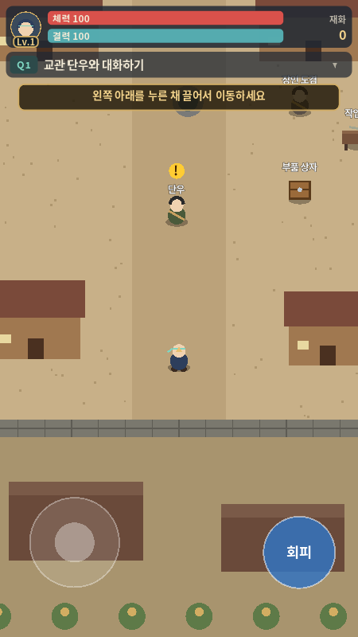
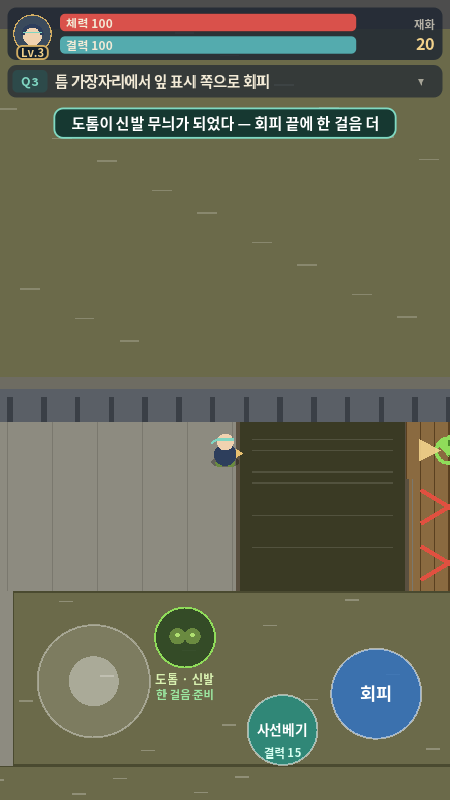
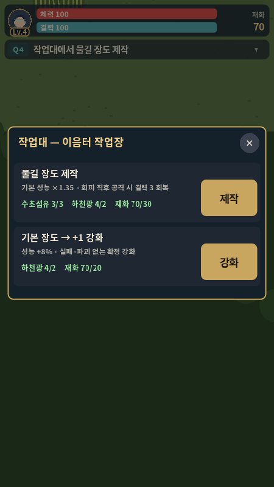
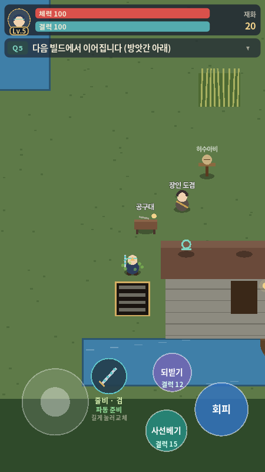

# Q3 수정 재검증·Q4 검토 — 2026-10-11

검토자: Codex — 총괄·디자인. 구현 기준: **`f8e66cb49fb2e90915a4b55b90971d21fed962b6`**, Q4 추가 커밋 `c715bf9` 포함.

**판정:** 이전 Q3 P1 두 건과 연습 재시도 문제는 해결을 확인했다. 기존 자동 점검 **125개 전부 통과**. 다만 허용된 조기 강화 경로에서 **Q4 진행이 막히는 P1 한 건**을 추가 재현했다. 이를 수정한 뒤 Q5로 진행한다. 이번 변경은 검토 문서·재현 장면·로그·캡처이며 게임 소스는 수정하지 않았다.

## 1. P1 — 물길 장도를 미리 +1 강화하면 Q4 완료 불가

### 플레이어가 겪는 순서

1. 도겸에게 도안을 제출하고 물길 장도를 제작한다.
2. 방앗간으로 떠나기 전에 마을 작업대를 다시 열어 **물길 장도 +1 강화**를 한다. UI에 허용된 선택이며 기존 퀘스트 보상만으로 비용을 지불할 수 있다.
3. 줄비 임시 동행 → 연결쇠 2개 해제 → 무료 수선·계약 → 검 변신·회피 후 파동을 정상 수행한다.
4. 목표는 **“공구대에서 장도 +1 강화”**로 바뀐다. 이미 +1인데도 완료되지 않는다.
5. 도겸에게 말을 걸어도 재료 재지급이 없다. 공구대에는 **+2 강화**만 나타나며 하천광 0/3, 재화 20/30이라 버튼이 비활성이다. Q4 보상과 Q5 입구가 열리지 않는다.

같은 초기 보상으로 마지막 안내 단계에서 +1 강화하는 대조 경로는 정상 완료했다. 조기 경로에 재료를 추가하거나 강화·보상을 강제 설정하지 않았다. 순간이동과 대사 넘기기는 이동 시간을 생략하는 준비 수단이며, 제작·강화는 HUD의 실제 숫자 키 입력 처리와 연결된 게임 로직을 썼다.

### 원인과 수정 방향

- [`main.gd`의 Q4_UPGRADE 진입](../../game/scripts/main.gd#L365)은 기존 장비 상태를 확인하지 않고 목표만 설정한다.
- [완료 판정](../../game/scripts/main.gd#L983)은 **그 단계에서 강화에 새로 성공했을 때만** 실행된다. 이전에 달성한 +1을 인정하지 않는다.
- [재료 재지급](../../game/scripts/main.gd#L924)은 `weapon_plus < 1`일 때만 가능하다. 따라서 조기 +1 경로에서 추가 강화 비용을 얻을 수도 없다.

**권장:** 줄비 파동 체험을 마치고 강화 단계로 넘어갈 때 `weapon == "물길 장도" && weapon_plus >= 1`이면 기존 달성을 인정하고 Q4 완료 흐름으로 이어진다. +0일 때만 강화 안내를 유지한다. 플레이어에게 +2를 요구하거나 보상 재료를 늘려 해결하지 않는다. 보상은 기존 `claim_reward("Q4")`로 1회만 지급한다.

후속 자동 점검은 **정상 +1**, **물길 장도 조기 +1**, **기본 장도 선강화 후 재료 부족 복구**를 각각 확인한다. 저장 구현 시 이미 강화된 장비로 이 단계에 진입하는 경우도 같은 완료 판정을 사용한다.

| 추가 재현 | 최종 상태 | 종료 코드 | 로그 |
| --- | --- | --- | --- |
| 제작 직후 물길 장도 +1 | Q4_UPGRADE, 보상 없음, 덮개 닫힘 | **1 (FAIL)** | [조기 강화](q4-early-f8e66cb.txt) |
| 마지막 안내에서 물길 장도 +1 | Q4_DONE, 보상 지급, 덮개 열림 | **0 (PASS)** | [대조 경로](q4-normal-f8e66cb.txt) |

## 2. 이전 문제 해결 확인

[이전 Q3 검토](q3-review-2026-10-11.md)의 재현 스크립트·장면은 변경 없이 사용했다. 두 파일을 `47f1dfb`와 비교해 변경이 없음을 확인했다.

| 이전 항목 | 이번 관찰 | 판단·근거 |
| --- | --- | --- |
| P1 대화 중 피격·사망 | 2.5초 읽기 후 HP 100 유지, HP 20으로 계속 읽어도 사망 0 | **해결**, [대화 로그](q4-dialogue-f8e66cb.txt), 종료 0 |
| P1 딱정벌레 돌진 무피해 | HP 100→82, 최근접 거리 약 1.478px, 플레이어 레이어 4·적 마스크 3 | **해결**, [돌진 로그](q4-beetle-f8e66cb.txt), 종료 0 |
| P2 틈 실패 후 대기 유지 | 출발점 복귀 시 결력 100·한 걸음 대기 0; 즉시 올바른 경로 재시도 시 낙하 없이 x≈805 도착 | **개선 확인**, [연습 로그](q4-practice-f8e66cb.txt) |

연습 재현은 관찰용이라 종료 코드만으로 성공을 판단하지 않고 위 위치·낙하·대기 값을 확인했다. 기존 자동 점검에서도 수동 대기 초기화가 사라지고 복귀 초기화 검사가 추가된 것을 확인했다.

대화·작업대·암전 중 적의 물리 처리를 멈추고 재개 시 0.8초 무적을 주는 방식은 현재 시제품에 적합하다. 플레이어 레이어 분리는 벽·틈에 대한 이동 마스크를 유지한다. 기존 진흙 통과 차단·틈 낙하·회피 점검도 통과했다.

## 3. 디자인 판단과 후속 항목

- **상단 HUD:** 상태와 한 줄 목표의 하단은 156px으로 180px 기준을 충족한다. 장비·재료 상세를 펼침 패널로 옮긴 방향을 유지한다. 시작 화면의 플레이어는 가로 50%·세로 56%다.
- **영물 교체:** 활성 1칸 유지, 짧게 누르기=변신 / 길게 누르기=교체는 시제품에서 유지한다. 교체 가능한 때 “길게 눌러 교체” 문구도 보인다. 휴대폰에서 발견 가능성과 동시 이동 입력을 확인하고, 이해하지 못하는 사용자가 많으면 선택 패널을 여는 작은 교체 버튼을 추가한다. 지금 활성 칸을 2개로 늘리는 변경은 하지 않는다.
- **P2 착지 미리보기 가독성:** 안전·위험 색과 대기 문구는 유용하다. 다만 이번 `q3_preview` 화면에서는 녹색 착지 원이 오른쪽 끝에서 일부 잘린다. 도톰의 일회성 카메라 이동 이후에도 틈 앞에서 착지 원·잎 전체를 볼 수 있도록 상황별 카메라 여백이나 화면 안 안내를 보완한다. 안전 판정을 바꾸는 요청은 아니다.
- **줄비 동행:** 4초마다 3의 값은 초기 검증용으로 유지한다. 현재 `_combat_chip()`은 `take_hit(3)`로 **체력 피해**를 주며 별도의 균형/경직 수치를 바꾸지 않는다. “균형 손상”을 독립된 전술 효과로 완성했다고 기록하지 않는다. Q5에서 동행이 틈을 만들지 검 효과를 고를지 선택 이유를 실제 플레이로 확인한다.
- **제작·강화:** 도안 등록·지원금 1회, 무료 손잡이 수선, 계약 전 변신 금지, 물길 장도 특성+줄비 파동 조합은 기획에 맞는다. 위 P1의 완료 판정만 먼저 보완한다.
- **방앗간·Q5 입구:** 현재 위치와 덮개 표시를 유지한다. 실제 던전 진행은 미구현이다.
- **아트:** 모두 도형 기반 시제품이다. 교육원 석조·목재 타일과 망토 캐릭터의 첫 자산 묶음이 여전히 필요하다. 마법 교육원 분위기 적용 완료로 판단하지 않는다.

| 시작 | 착지 미리보기 |
| --- | --- |
|  |  |

| 제작 패널 | Q4 완료·덮개 |
| --- | --- |
|  |  |

제작 캡처는 장면 준비 중 순간이동과 남은 카메라 이동 연출 때문에 플레이어가 화면 밖에 있다. 제작 패널의 배치·문구 검토에만 사용했다. 정상 도보 접근에서 캐릭터가 화면 밖으로 나간다는 증거로 해석하지 않는다. 완료 캡처는 상태를 일부 준비하는 기존 캡처 도구 결과이며 Q4 정상 진행 증거는 위 대조 재현 로그다.

## 4. 검증 환경·실행 방법

검증 엔진: **Godot 4.6.3.stable.official.7d41c59c4 / Linux 클라우드**. Claude의 4.7.2/Windows 결과는 협업 현황 9장에 따로 있다. 이번 실행은 4.6.3에서의 확인이며, 4.7.2 또는 Android 실행으로 표기하지 않는다.

기존 점검: **Q1 22/22, Q2 21/21, Q3 25/25, 영물 11/11, Q4 31/31, HUD 8/8, Codex 재현 7/7 = 125/125, 종료 코드 0.** [전체 로그](q4-autotest-f8e66cb.txt). 이 통과 결과가 허용된 모든 행동 순서의 성공을 의미하지는 않는다.

저장소 루트에서 실행:

```bash
XDG_DATA_HOME=/tmp/naruto-review-data XDG_CACHE_HOME=/tmp/naruto-review-cache \
  godot --headless --path game -- --autotest

# 이전 대화 재현. 끝에 -- --beetle 또는 -- --practice를 붙여 다른 항목 실행.
XDG_DATA_HOME=/tmp/naruto-review-data XDG_CACHE_HOME=/tmp/naruto-review-cache \
  godot --headless --path game "$PWD/docs/reviews/q3-review-probe.tscn"

# 신규 P1: 조기 +1 경로. 수정 전 종료 1.
XDG_DATA_HOME=/tmp/naruto-review-data XDG_CACHE_HOME=/tmp/naruto-review-cache \
  godot --headless --path game "$PWD/docs/reviews/q4-review-probe.tscn"

# 대조: 마지막 안내 단계에서 +1. 종료 0.
XDG_DATA_HOME=/tmp/naruto-review-data XDG_CACHE_HOME=/tmp/naruto-review-cache \
  godot --headless --path game "$PWD/docs/reviews/q4-review-probe.tscn" -- --normal
```

Windows에서는 실제 Godot 실행 파일과 장면의 절대 경로를 사용한다. 재현은 게임의 autoload를 유지하는 별도 Node 장면이며 실제 게임의 시작 장면은 바꾸지 않는다. 준비 실패는 종료 2, 완료 조건 실패는 종료 1이다.

캡처는 Xorg dummy·소프트웨어 OpenGL·Dummy 오디오로 450×800 PNG를 생성했다. V-Sync 지원 경고가 있었으며 실기기 성능·소리의 정상 재생을 검증한 것은 아니다. 이동은 순간이동·직접 호출을 포함한다. 휴대폰 멀티터치, 길게 누르기의 조작감, 진행 시간, 저장·재접속은 아직 미검증이다.

## 5. Claude에게 전달할 작업

> 최신 저장소를 받고 이 보고서의 P1부터 수정해줘. 물길 장도를 제작하자마자 마을 작업대에서 +1 강화해도, 이후 줄비 계약과 파동 체험을 마치면 Q4 완료가 인정되어야 해. +2를 요구하거나 재료를 추가 지급하는 우회는 하지 말고, 강화 단계 진입 시 기존 달성을 확인해줘. 기존 125개 점검과 Q4 재현의 기본·--normal 양쪽을 통과시키고 보상 1회도 확인해줘. 그다음 착지 원 잘림을 보완하고 Q5 구현으로 진행하면 돼. 영물 1칸·교체 조작과 축소 HUD는 유지하고, 교육원 아트와 실제 휴대폰 확인은 별도 미완료 항목으로 기록해줘.
