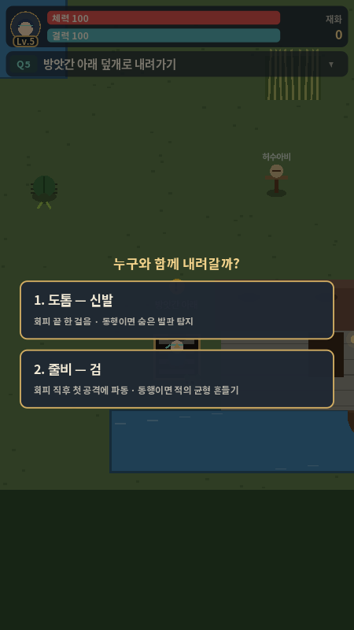
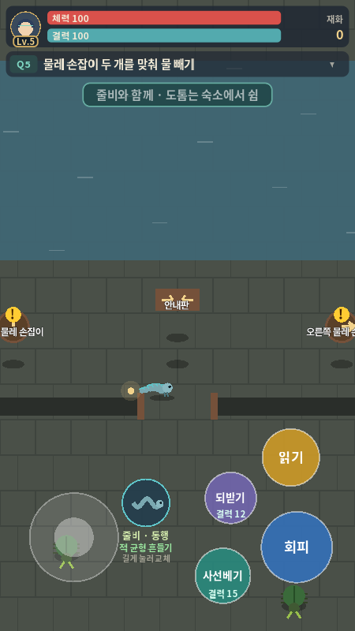
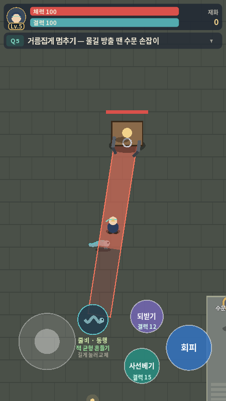
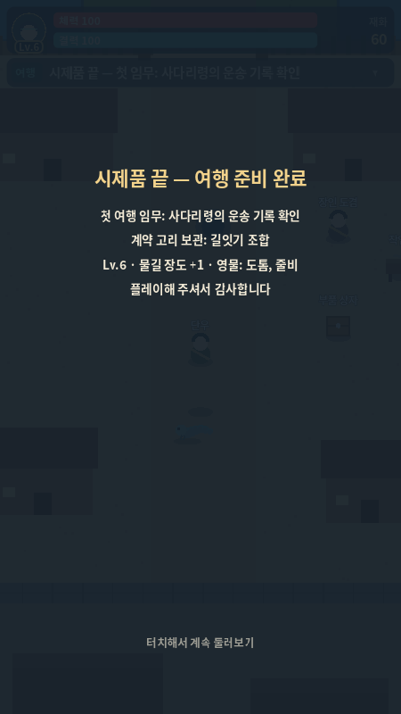

# Q5 검토·교육원 자산 전달 — 2026-10-11

Codex — 총괄·디자인. 구현 기준: **`6a77e3e`**, Q4 수정 `6382351` 포함. Godot **4.6.3.stable.official.7d41c59c4 / Linux**에서 확인했다. Claude의 4.7.2/Windows 기록과 구분한다.

**판정:** Q4의 조기 강화 차단 문제는 해결됐다. 기존 자동 점검 **158/158, 종료 0**. Q5 기본 흐름은 저장·Android 작업을 진행할 수 있는 상태다. 아래 P2 안내·호위 보완을 첫 휴대폰 빌드에 함께 반영한다. 이번에 게임의 전투·퀘스트 코드는 바꾸지 않았으며, 별도 재현 도구와 교육원 첫 자산을 추가했다.

## 1. Q4 수정 확인과 실행 근거

이전 Q4 재현 장면을 변경 없이 실행했다. 기본(조기 +1)과 `--normal` 모두 Q4_DONE·보상 지급·덮개 열림으로 끝나며 종료 코드 0이다. 조기 경로에서 추가 +2나 추가 재료를 요구하지 않는다.

- [전체 158개 로그](q5-autotest-6a77e3e.txt): Q1 22, Q2 21, Q3 25, 영물 11, Q4 31, HUD 8, Codex 재현 8, Q5 32.
- [Q4 조기 +1](q5-q4-early-6a77e3e.txt), [Q4 정상 +1](q5-q4-normal-6a77e3e.txt).

자동 점검은 함수 호출·순간이동을 사용한다. 실제 사람의 전체 보스 클리어, 휴대폰 입력·성능, 저장과 재접속은 통과로 기록하지 않는다.

## 2. 요청한 다섯 항목에 대한 판단

### 보스 수치 — 피해·체력 유지, 첫 방출 안내에 여유 추가

체력 320, 집게 22/예고 0.9초, 쓸기 16/예고 1.0초, 방출 플레이어 20·정비공 30은 **초기 수치로 유지**한다. 일반 회피로 집게·쓸기를 피하고 빈틈 1.5배가 적용되는 것을 기존 점검에서 확인했다. 휴대폰 난이도 확정은 아니다.

**P2:** 물길 방출 3.2초는 첫 안내를 읽고 경로를 찾는 시간까지 충분하다고 보기 어렵다. 수문 바로 옆으로 순간이동한 기존 테스트와 별개로, 보스 근접 위치 `(1290,314)`에서 난간 아래로 돌아 수문에 실제 이동했다. 줄비 검, 도톰 신발 없음, 회피 2회 조건이다.

| 이동 조건 | 수문 활성 시점 | 관찰 |
| --- | --- | --- |
| 경로를 알고 즉시 출발 | 약 2.55초 | 피해 없이 대응, 여유 약 0.65초 |
| 같은 경로, 0.6초 기다린 뒤 출발 | 약 3.15초 | 피해 없이 대응했지만 남은 시간 약 0.05초 |
| 수문 바로 옆에서 시작 | 즉시 | 기존 근처 테스트의 대조 조건 |

[이동 로그](q5-far-6a77e3e.txt), [0.6초 지연 로그](q5-reaction-6a77e3e.txt), [근처 대조 로그](q5-near-6a77e3e.txt). 지연 0.6초는 검토용 가정이며 사용자 반응속도 측정이 아니다. `flood_at`은 벽시계, `activated_at`은 물리 프레임 누적 시간이라 정확한 같은 시계 비교에는 쓰지 않는다.

**첫 휴대폰 빌드 권장 가설:** 첫 방출 예고 **4.5초**, 이후 **4.0초**로 시작한다. 방출 중 HUD 목표 위치를 수문으로 바꾸어 화면 밖 화살표를 보여주고, 확보 후에는 안전 발판으로 안내한다. 숫자 카운트 또는 차오르는 수위와 **“수문 내리기 → 발판 안에서 대기”**를 함께 보여준다. 단순히 “오른쪽”만 읽고 화면 밖 손잡이를 찾게 하지 않는다. 실제 터치 결과가 나오면 수치를 다시 조정한다.

정비공 체력 60에서 방출 두 번을 놓치면 실패하는 규칙은 유지한다. 첫 실패는 수문 대응을 배우는 재도전으로 연결하되, 위 경로 안내를 먼저 보완한다.

### 배수 퍼즐 — 방향 구조 유지, 짧고 구체적인 안내

**유지:** 안내판·손잡이 화살표, 맞은 방향의 녹색 테두리. 왼쪽 → / 오른쪽 ←가 맞을 때만 배수되고 실제로 웅덩이를 걸어서 통과하는 것을 확인했다.

현재 화면 중앙에 안내판은 잘 보이지만 두 손잡이는 양옆 화면 끝에 걸친다. 안내판 문구를 **“두 화살표가 서로를 향하게 돌리세요. 왼쪽 →, 오른쪽 ←.”**로 정리한다. 손잡이마다 누르면 90도 회전한다는 첫 안내를 짧게 보여주고, 맞을 때는 녹색 외에 작은 체크나 고정 표시를 추가한다. 미해결 상태가 오래 지속될 때만 방향 예시를 다시 보여준다. 새 퍼즐이나 타이머를 추가하지 않는다.

### 영물 선택 문구 — 영물과 장비 상태 구분

**P2:** 지금 제목 “줄비 — 검”을 선택해도 실제 입장은 **줄비 동행**이다. 선택 함수는 활성 영물만 바꾸며 검으로 자동 변신시키지 않는다. 같은 영물을 고르면 이전 폼이 유지될 수도 있다. [재현 로그](q5-choice-6a77e3e.txt).

권장 문구:

| 제목 | 설명 |
| --- | --- |
| **도톰과 함께** | 동행: 숨은 발판 탐지 / 신발: 회피 뒤 한 걸음 |
| **줄비와 함께** | 동행: 가까운 적 보조 공격 / 검: 회피 뒤 첫 공격에 파동 |

선택 아래 **“초상화를 누르면 동행·장비를 바꿀 수 있어요”**를 표시한다. 실제 입장 폼은 HUD에 나타나야 한다. 현재 줄비 동행은 체력 피해 3이며 별도의 균형·경직 시스템은 없으므로 **“균형 흔들기”**를 구현된 전술 효과처럼 안내하지 않는다. 활성 1칸과 두 영물 모두 클리어 가능한 설계는 유지한다.

### 끝 카드 — 결과 반영 유지, 다음 지역 개방 여부 명시

보관처 선택·레벨·무기·계약 영물을 반영하고, “터치해서 계속 둘러보기”로 돌아가는 구성은 유지한다. 두 보관 선택은 다음 이야기의 관점 차이이며 이번 시제품에 별도 보상 차이는 없다.

사다리령이 현재 플레이 가능한 것으로 오해하지 않도록 본문에 **“사다리령 여행은 다음 버전에서 이어집니다.”**를 추가한다. 저장이 구현되기 전에는 “저장 완료”를 표시하지 않는다. 저장 구현 후에도 실제 쓰기 성공을 확인한 경우만 저장 안내를 표시한다. 끝 카드 뒤 단우의 반복 대사는 보관 결과와 다음 임무를 짧게 회상하는 문구로 보완할 수 있다.

### 정비공 안내 — 간단한 호위 유지, 난간 경로 보완

구조 후 따라오기, 방 사이 문을 거치기, 안전 지대에서 기다리기, 실패 시 방 입구 재시작을 유지한다. 플레이어 120·정비공 108 속도는 첫 호위에 적합한 초기값이다.

**P2:** 방 사이 문 경로와 달리 같은 방에서는 플레이어/대기 지점으로 직선 이동한다. `(1480,510)`에서 `(1600,510)`의 플레이어를 따라갈 때 발판 왼쪽 난간 `Rect2(1554,470,6,104)`을 통과하고 대기 자리로 들어가는 것을 재현했다. [난간 로그](q5-worker-6a77e3e.txt). 진행을 막는 문제는 아니지만 안전 발판 입구가 있다는 공간 설명과 맞지 않는다.

첫 빌드는 발판 입구 아래 `(1524,600) → (1588,600) → 대기 자리` 같은 **고정 경유점**을 추가하면 충분하다. 현재 지형에서 문 경유 방식도 유지한다. 벽 없는 직선 이동을 완성된 충돌/경로 탐색으로 표기하지 않는다. 실제 플레이에서 보리가 화면 밖이면 이름·따라오는 상태를 작게 표시하고, 안전 지대에 도착하면 “보리 대기 중”을 확인할 수 있게 한다.

## 3. 화면 확인

| 영물 선택 | 배수 퍼즐 |
| --- | --- |
|  |  |

| 집게 예고 | 끝 카드 |
| --- | --- |
|  |  |

450×800 PNG를 실제 생성해 확인했다. Linux Xorg dummy·소프트웨어 OpenGL·Dummy 오디오 조건이며 V-Sync 지원 경고가 있었다. 휴대폰 성능이나 소리 확인이 아니다. 캡처 도구는 장면을 준비하며 전투를 일부 강제로 진행하므로 정상 전체 클리어 증거는 아니다.

## 4. 교육원 자산 — 적용 시작 가능

**첫 자산 준비 완료:** 플레이어·단우 32×40/4방향 스프라이트, 이동·정지 SpriteFrames, 32px 타일 16종과 TileSet, 아치·램프·책장·상자, 오리지널 플레이어 초상화 원본. [자산 안내·적용 지침](../../game/assets/README.md), [미리보기](../reference/academy-assets-v0.1.png).

픽셀 자산은 새 캔버스에서 직접 작성한 원본이며, 초상화는 생성 도구로 제작한 투명 PNG 원본을 그대로 보존했다. 실제 게임의 장면에는 아직 적용하지 않았다. **P1-2는 자산 제공 완료 / 게임 적용·재검증 대기**다. 다른 NPC·영물·적·공격 전용 프레임은 후속 묶음이다.

Godot에서 애니메이션 2×8개, 이동 각 4프레임, 타일 16개, PNG 로드를 실제 확인했다. [자산 검사 로그](academy-assets-check-4.6.3.txt). 그림만 교체하고 기존 충돌·퀘스트·공격 예고·영물 상태 표현을 보존한다.

## 5. 다음 작업과 Claude 전달문

저장·Android 첫 빌드 작업을 진행해도 된다. [저장·Android 인수 기준](../save-and-android-v0.1.md)에 재접속·보상 중복·던전 재도전 조건을 정리했다. 아트는 별도 커밋에서 첫 구역만 적용하고, P2 안내와 경유점을 첫 휴대폰 빌드에 함께 반영한다.

> `6a77e3e`의 158개 점검과 Q4 두 재현은 Codex 4.6.3에서도 통과했어. 저장·Android 첫 빌드를 이어가줘. `game/assets/README.md`의 교육원 첫 자산을 적용할 수 있어. 보스 체력·피해는 유지하고 첫 방출 4.5초/이후 4.0초를 초기 모바일 가설로 적용해줘. 방출 때 수문→발판 안내, 선택 제목 “도톰/줄비와 함께”와 폼 설명, 줄비 동행의 실제 보조 공격 문구, 끝 카드의 다음 버전 안내, 보리의 발판 입구 경유점을 보완해줘. 아트·저장·Android는 커밋을 나누고, 실제 사용 엔진 버전·검사·APK·휴대폰 결과를 현황 문서에 남겨줘.

추가 관찰 도구는 저장소 루트에서 `godot --headless --path game "$PWD/docs/reviews/q5-review-probe.tscn"`으로 실행한다. 뒤에 `-- --near`, `-- --reaction`, `-- --worker`, `-- --choice`를 붙일 수 있다. 관찰 도구의 종료 0은 스크립트 실행 완료이며 모바일 난이도/경로의 합격 판정이 아니다.
