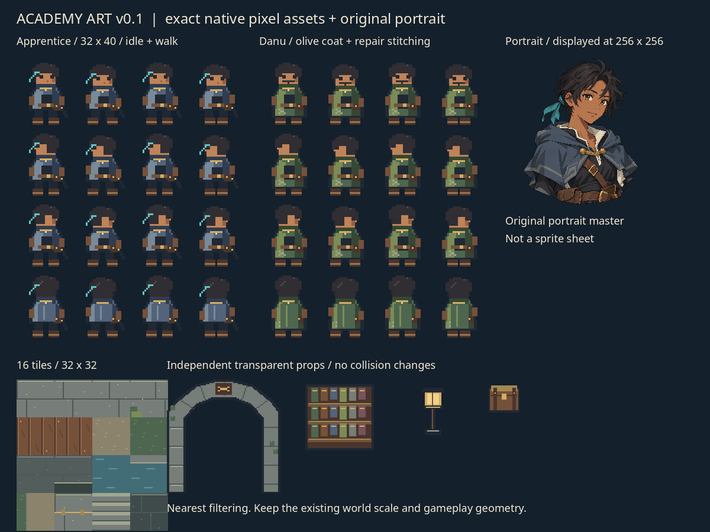

# 교육원 첫 아트 묶음 v0.1

Codex 제작 / 2026-10-11. 적용 시작용 자산이다. 게임 장면에는 아직 연결하지 않았다.



## 파일과 규격

| 파일 | 규격·내용 |
| --- | --- |
| `characters/apprentice-walk.png` | 128×160 RGBA. 32×40 프레임 16개, 청회색 짧은 망토·청록 매듭·부츠·도구 주머니 |
| `characters/danu-walk.png` | 같은 규격. 올리브 긴 작업 코트·수선 자국·턱수염 |
| `characters/*-frames.tres` | Godot SpriteFrames. `idle_down/left/right/up`, `walk_down/left/right/up`. 이동 6fps |
| `tiles/academy-tiles.png` | 128×128, 32×32 타일 16종. 석재·목재·흙·풀·벽·물·황동 선·계단 |
| `tiles/academy-tileset.tres` | Godot TileSet. Atlas source ID 0. 충돌 데이터 없음 |
| `props/stone-arch.png` | 96×96 RGBA. 독립 석조 아치·매듭 장식·이끼 |
| `props/brass-lamp.png` | 32×48 RGBA. 독립 황동 램프 |
| `props/oak-bookshelf.png` | 64×64 RGBA. 독립 참나무 책장 |
| `props/parts-crate.png` | 32×32 RGBA. 부품 상자 |
| `portraits/apprentice-master.png` | **1254×1254 RGBA 원본**. 생성 도구로 제작한 오리지널 플레이어 초상화. 대화 UI에서 256×256 영역에 맞춰 표시 |
| `academy-manifest.json` | 타일 좌표·애니메이션 순서·발 기준·오브젝트 크기 |

픽셀 자산은 새 빈 캔버스에서 직접 작성한 팔레트 기반 원본이다. 생성 초상화를 잘라 스프라이트로 만든 것이 아니다. 초상화 원본은 수정 없이 보존했다. 캐릭터의 청회색 망토·청록 천 매듭·황동 잠금·짙은 머리색을 두 매체에서 맞췄다.

## Claude 적용 지침

1. **첫 적용 범위는 플레이어·단우와 이음터 시작 구역이다.** 나머지 NPC·영물·적의 도형은 우선 유지한다. 충돌·상호작용·퀘스트 좌표는 기존 코드가 기준이다.
2. 플레이어/단우의 기존 몸 그림만 새 `AnimatedSprite2D`로 대체한다. 직접 그린 그림자·공격 예고·피격·기술·영물 효과는 유지한다. 중복된 머리·몸·부츠가 새 그림 아래 보이지 않게 한다.
3. `SpriteFrames`를 연결하고 기본 애니메이션 `idle_down`, `texture_filter = NEAREST`, `centered = true`를 쓴다. **이 묶음의 오프셋은 `(0, -10)`**이다. 발 기준이 프레임 `(16,38)`이라 로컬 `(0,8)`에 맞는다. 초기 명세의 `(0,-12)`는 프레임 바닥이 y=40인 경우의 시작 가설이었다.
4. 속도 0이면 `idle_{direction}`, 이동이면 `walk_{direction}`. 큰 축을 기준으로 방향을 고르되 이동이 멈췄을 때 마지막 방향을 유지한다. 기존 `facing`과 전투 방향을 바꾸지 않는다. NPC 이동은 기존 위치 변화에서 방향을 얻는다.
5. 신발·검 상태의 영물 표식, 준비·피격·회피 연출은 새 몸 위에 별도 효과로 남긴다. 초상화만 보고 현재 신발/검 상태를 추정하게 하지 않는다.
6. 기존 32px 월드 단위로 타일을 배치한다. 필요하면 타일을 **기존 충돌 뒤의 장식 레이어**로 쓰고, 새 TileSet에서 충돌을 자동 생성하지 않는다. 타일 ID는 manifest의 `(열,행)`이다. 전체 시안 그림을 배경으로 붙이지 않는다.
7. 아치·책장·램프는 기존 문·벽·집 경계에 맞춰 배치한다. 각 PNG의 바닥 기준을 manifest에서 확인하고 앞/뒤 레이어를 구분한다. 96px 아치를 기존 좁은 문 폭에 억지로 놓아 이동 가능한 곳을 기둥으로 가리지 않는다.
8. 초상화는 대화 UI에만 쓰며 종횡비·투명 여백을 보존한다. **초상화에는 LINEAR, 픽셀 월드에는 NEAREST**를 쓴다. 초상화 원본을 32×40으로 축소해 월드에 사용하지 않는다.

세계관의 유명 학교 문장·특정 작품 인물·금속 이마 보호대를 사용하지 않았다. 타일 장식은 고유한 매듭·수로·수선 흔적이다. 아직 다른 NPC의 초상화, 도톰/줄비 스프라이트, 공격·회피 전용 프레임은 이 묶음에 없다.

## 제작·확인

픽셀 원본 재생성(개발 도구에만 Pillow 필요, 게임 실행에는 불필요):

```bash
python3 tools/build-academy-assets.py
```

Godot에서 리소스 불러오기 확인:

```bash
godot --headless --editor --path game --import
godot --headless --path game "$PWD/tools/academy-preview.tscn" -- --check
```

Linux 제한 환경에서는 `XDG_CONFIG_HOME`, `XDG_DATA_HOME`, `XDG_CACHE_HOME`을 쓰기 가능한 임시 경로로 지정한다. Windows에서는 실제 실행 파일과 장면의 절대 경로를 쓴다. `--check` 없이 실행하면 별도의 자산 미리보기를 생성한다(현재 캡처 경로 `/tmp/naruto-academy-assets-preview.png`는 검토 환경용이다).

Godot **4.6.3**에서 SpriteFrames 2개×8 애니메이션·각 이동 4프레임과 TileSet 16타일을 실제 불러왔다. [검증 로그](../../docs/reviews/academy-assets-check-4.6.3.txt). 게임 플레이에 적용한 결과나 휴대폰 검증은 아니다.

적용 후 기존 Q1 22개와 전체 점검을 통과하고, start·dialogue·aim·reward를 450×800으로 캡처한다. 머리·망토·발 위치·NPC 접근·공격 예고·영물 표식이 유지되는지 Codex가 다시 검토한다. P1-2는 **첫 자산 준비 완료 / 게임 적용·플레이 검증 대기**로 기록한다.
